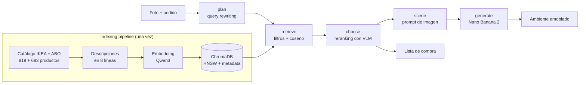

# amoblai

Amoblado virtual con RAG sobre un catálogo real de muebles. Trabajo práctico de 73.69 Large
Language Models (ITBA, 2026).

**Entrada:** una foto del ambiente (y, opcional, otra foto del mismo ambiente desde otro ángulo) y
el pedido en texto libre ("un living nórdico y cálido"). **Salida:** los productos del catálogo
que hacen falta, con cuántas unidades de cada uno (lista de compra), y la foto del ambiente con
ellos. El catálogo junta dos: IKEA (Tautkute et al., 819 productos) y Amazon Berkeley Objects
(683).

## Cómo funciona



| Etapa | Código (`src/amoblai/`) | Qué hace |
|---|---|---|
| Data loading | `dataset/` | Descarga el dataset IKEA fijado a un commit, lo carga con un unpickler restringido y une todo por SKU. |
| Preprocesamiento | `catalog/` | Los productos del alcance (muebles de living, comedor y escritorio, lámparas y decoración) con su tipo, kind y medidas; correcciones y exclusiones a mano. |
| Splitting | `datos/catalogo/descripciones.jsonl` | Un documento por producto (la descripción es corta): ocho líneas fijas (Type, Use, Style, Materials, Colors, Shape, Feel, Goes with), escritas por subagentes mirando la foto. |
| Embedding y base vectorial | `rag/embed.py`, `rag/store.py`, `rag/index.py` | Qwen3-Embedding (local) → ChromaDB: vector, descripción y metadata por producto, índice HNSW en espacio coseno. |
| Pre-retrieval: query rewriting | `furnish/steps.py` (`plan`) | Claude lee la foto y el pedido, decide las piezas (hasta seis: los muebles primero, después lámparas y deco si se pide amoblar), su kind y su tamaño máximo, y escribe el producto ideal en las mismas ocho líneas que el catálogo. |
| Retrieval | `rag/search.py`, `rag/filters.py` | Filtros duros de metadata (kind, medidas) como `where` de ChromaDB, después los k más cercanos por coseno. |
| Post-retrieval: reranking | `furnish/steps.py` (`choose`) | Claude mira la foto y los candidatos de cada pieza y elige la mejor combinación. |
| Generación | `furnish/steps.py` (`scene`), `furnish/image_models.py` | Claude escribe el prompt; el modelo de imagen (Nano Banana 2 por fal, gpt-image o a mano) pone los productos en la foto. |
| Evaluación | `evaluation/` | Retrieval sobre los livings y comedores IKEA anotados (hit@k, MRR, context precision/recall, NDCG) y sus ablaciones (`datos/configs/ablaciones/`); relevancia graduada con un juez; la imagen generada (fidelidad de producto, ambiente preservado); RAGAS sobre la respuesta; el espacio de embeddings. |

## Resultados

Retrieval sobre los 65 livings y comedores de IKEA con productos anotados, con el catálogo
ampliado y revisado (819 productos: se sacaron 36 con la foto de otro producto o que no son de
living ni comedor). Hay 549 consultas con respuesta: muebles (sofás, sillones, sillas, mesas,
alfombras) y lo que sumó la ampliación (lámparas, deco, guardado, estanterías...). IC 95%
bootstrap por ambiente. Tablas completas en `datos/resultados/reporte/reporte.md`.

| Configuración | hit@1 | hit@10 | MRR@10 | context precision@10 | context recall@3 |
|---|---|---|---|---|---|
| Naive: texto del vendedor, hashing de palabras, sin filtro | 0,077 | 0,312 | 0,142 | 0,141 | 0,205 |
| + nuestras descripciones de ocho líneas | 0,495 | 0,871 | 0,618 | 0,604 | 0,745 |
| + Qwen3-Embedding, filtro por tipo, ChromaDB | 0,535 [0,49–0,58] | 0,893 | 0,654 | 0,632 | 0,785 |
| **+ reranking: Claude Opus 5.5 ordena el top-10 mirando las fotos** | **0,687** | 0,893 | **0,760** | | |
| Azar (con el filtro por tipo) | 0,017 | 0,161 | | | |

- **Por pasada:** en los muebles del primer alcance, hit@1 0,633 (0,636 con el catálogo de 268:
  587 productos más casi no lo mueven); en lo nuevo, 0,476. Por categoría: sillas 0,84,
  muebles de guardado 0,72, mesas 0,69, lámparas 0,59, deco 0,36, alfombras 0,31. Deco y
  alfombras son lo difícil: muchos productos parecidos (53 almohadones, 89 alfombras) y la
  anotación de IKEA no dice cuál de los del ambiente es.
- **Reranking:** Opus 5.5 mirando las fotos del top-10 sube hit@1 de 0,535 a 0,687 en el
  catálogo final (US$0,02 por consulta). Con el catálogo de 268 y solo muebles, de 0,636 a
  0,803: el catálogo final tiene más productos parecidos.
- **Query rewriting:** con la consulta en las ocho líneas del catálogo, hit@1 da 0,535. Con solo
  la línea Type cae a 0,293, y con solo el nombre del kind (sin reescribir) a 0,064.
- **Base vectorial:** ChromaDB (HNSW) y la búsqueda exacta dan el mismo ranking en las 864
  consultas con filtro por tipo (con filtro por kind, en 863; el primero coincide en todas).
- **Texto contra imagen:** con el mismo ground truth y el catálogo que vio la v0 (275), el
  retrieval por texto da 0,618 de hit@1 y el mejor retrieval por imagen de la v0 (DINOv3), 0,508.
- **Reproducibilidad:** con las consultas escritas tres veces por subagentes independientes,
  el mejor método da hit@1 0,544 ± 0,026 y MRR 0,655 ± 0,017. Qwen3 le gana a BGE, a hashing y
  al filtro por kind en las tres escrituras.
- **Cuántos candidatos (k):** si el VLM elige entre los primeros k, acierta 0,637 con 3, 0,667
  con 5 y 0,689 con 8 (sale del mismo reranking). El techo, hit@k, es 0,732, 0,812 y 0,876. El
  flujo le pasa 5 por pieza.
- **Dimensión del embedding:** Qwen3 truncado (Matryoshka) da 0,428 con 32 componentes, 0,506
  con 128 y 0,532 con 512, casi igual que con 1024.
- **Splitting:** un documento por producto (0,535) gana a un chunk por línea (0,273) y a comparar
  línea contra línea (0,514).
- **Reranking con un cross-encoder de texto** (MiniLM de MS MARCO, gratis): empeora (0,419). El
  que sirve mira las fotos.
- **Relevancia graduada** (un juez califica el top-3 con 2/1/0 contra la pieza del ambiente,
  sobre 150 consultas): el primer candidato sirve en el 75% de los casos y alguno del top-3 en el
  84%, también cuando el producto exacto no está en el catálogo (63% y 73%). El juez le da 2 al
  anotado en el 81% de los casos y a los demás en el 5%.
- **La imagen generada** (prueba-alvear2):
  - los 4 productos aparecen;
  - 3 de 4 se reconocen como el producto exacto al comparar el recorte con la foto del catálogo
    (DINOv3), con coseno medio 0,68; con fotos reales de IKEA, ese reconocimiento da 0,444 y
    coseno 0,41;
  - SSIM fuera de los muebles 0,975, y la cámara no se movió (SIFT).
- **RAGAS sobre la respuesta en texto:** faithfulness del porqué 0,89 a 0,96 (lo que no se
  sostiene son medidas que el catálogo no tiene); answer relevance 0,69 a 0,73, contra 0,37 de
  pedidos no relacionados.

- **Qué catálogo, de punta a punta:** se usaron 11 ambientes vacíos reales, cada uno con un pedido
  escrito como lo escribiría un usuario. Un juez (Opus, de a pares, en los dos órdenes) compara
  las listas.
  - Solo, ABO le pierde a IKEA 4 a 0 en los 5 ambientes propios, cuyos pedidos son nórdicos.
  - IKEA + ABO le gana a IKEA solo 8 a 2 (1 empate). En los nórdicos empatan; en los 6 públicos,
    con pedidos industrial, clásico, bohemio y otros, gana 6 a 0, y el porcentaje de productos
    útiles sube de 0,46 a 0,71.
  - Con ABO como distractores, el retrieval sobre el ground truth de IKEA casi no cambia: hit@1
    pasa de 0,535 a 0,525.
  - El flujo usa los dos catálogos. Las evaluaciones con ground truth, solo IKEA. Resultados en
    `datos/resultados/punta_a_punta/`.
- **Réplica de un ambiente real (el generador, con la lista ya decidida):** se toma un living del
  ground truth de IKEA, se vacía con Nano Banana 2 y se vuelve a amoblar con sus 6 muebles
  anotados, 3 veces sin cajas, 3 con rectángulos y 3 con cajas 3D dibujadas donde está cada mueble
  en la foto real (y una ronda 2 con prompts cortos, abajo). Es una sola habitación: son resultados de una prueba, no una medición.
  - Sin cajas: los 6 productos aparecen y se reconocen (coseno DINOv3 0,63), pero cada vez arma su
    propio living: IoU medio con las cajas reales 0,20, 1 de 6 en su lugar (IoU ≥ 0,5).
  - Con cajas: IoU 0,40 y 2,7 de 6 en su lugar. Las cajas acomodan los muebles grandes (sofá,
    estantería, alfombra), no los chicos que se superponen (puf, mesa ratona, lámpara). En 2 de 3
    imágenes quedaron las cajas dibujadas.
  - Con cajas 3D (un prisma en perspectiva apoyado en el piso, con el volumen de cada mueble;
    `evaluation/cajas3d.py`: profundidad métrica de Depth Pro, máscaras de SAM, piso y pared por
    RANSAC, gratis): IoU 0,48 y 3,3 de 6 en su lugar. La que más gana es la lámpara (0,16 → 0,57:
    el rectángulo marcaba solo lo que se veía; el prisma llega al piso). En 1 de 3 imágenes quedaron
    las cajas dibujadas, y en otra repitió el puf.
  - Ronda 2: prompts cortos que dicen qué hacer, iguales salvo en cómo dicen dónde va cada mueble,
    y dos formas nuevas de decirlo: en palabras (una o dos frases por mueble, que escribe Opus
    mirando la foto real) y con las cajas en una imagen guía aparte (la foto 1 va limpia). IoU / en
    su lugar: sin cajas 0,20 / 0,7; en palabras 0,37 / 1,7, sin nada que borrar; cajas 2D 0,43 /
    3,3; guía 2D 0,36 / 2,3; **cajas 3D 0,52 / 4,0, y ninguna quedó dibujada**; guía 3D 0,38 / 2,3.
    La guía aparte ubica peor y tampoco evita que las dibuje (1 de 3).
  - Resultados en `datos/resultados/replica/living-dagarna/` (US$2,40 de fal en total, una imagen
    se perdió con el disco lleno; US$0,03 de Opus para los lugares en palabras).


Una corrida completa del flujo cuesta unos US$0,30: plan y choose con Claude Opus 5.5 (US$0,07
y US$0,16, con 5 candidatos por pieza) y la imagen con Nano Banana 2 (US$0,08 por intento; si el
control SIFT la rechaza, se reintenta hasta 3 veces). Ejemplos: `datos/resultados/amoblar/caballito-living/`
y `datos/resultados/amoblar/caballito-comedor/`.

## Instalación

Requisitos: Python 3.11+ y [uv](https://docs.astral.sh/uv/).

```bash
uv sync --extra cpu --group dev --group apps     # sin GPU NVIDIA
uv sync --extra gpu --group dev --group apps     # con GPU NVIDIA (CUDA 12.6)
cp .env.example .env                             # ANTHROPIC_API_KEY, FAL_KEY, OPENAI_API_KEY
```

## Uso

El repo trae `datos/` completo: el dataset IKEA y ABO, lo procesado, la caché (descripciones,
vectores, ChromaDB, respuestas ya pagadas de Claude) y las fotos. Los dos primeros comandos solo
hacen falta para rehacerlo desde cero.

```bash
uv run amoblai data download     # dataset IKEA (Tautkute et al., 2017) en datos/dataset/
uv run amoblai catalogo          # el catálogo: productos, descripciones, kinds, correcciones
uv run amoblai catalogo-abo      # el catálogo alternativo (ABO): metadata, fotos, selección
                                 #   (--describir --pagar: las descripciones que falten, por la API)
uv run amoblai data ambientes    # las fotos públicas de ambientes vacíos (publicas.yaml)
uv run amoblai indice            # descripciones → embeddings → ChromaDB (en caché, gratis)
uv run amoblai buscar "Type: armchair, lounge reading chair
Materials: bentwood, leather" --kind armchair

# El flujo completo (se retoma donde quedó; nada se paga dos veces)
uv run amoblai amoblar datos/ambientes_vacios/ambiente2-alvear/alvear2.jpg "un living nórdico y cálido" \
    --vista datos/ambientes_vacios/ambiente2-alvear/alvear1.jpg \
    --set 'budget.allow_paid_steps=[furnish.plan, furnish.choose, furnish.scene]'   # imagen a mano
uv run amoblai amoblar foto.jpg "un comedor para seis" --generador nano_banana_2 --pagar

# Evaluación: cada ablación es un YAML de datos/configs/ablaciones/
uv run amoblai evaluar                                                        # gratis, local
uv run amoblai evaluar --ablacion datos/configs/ablaciones/reranking.yaml --estimar  # cuánto costaría
uv run amoblai evaluar --ablacion datos/configs/ablaciones/reranking.yaml --pagar
uv run amoblai evaluar --ablacion datos/configs/ablaciones/reproducibilidad.yaml --replica r2
uv run amoblai evaluar-graduada  # relevancia graduada del top-3 (--armar N: los lotes del juez)
uv run amoblai evaluar-imagen --referencia   # la imagen generada, y la vara con fotos reales
uv run amoblai evaluar-respuesta # faithfulness y answer relevance (RAGAS) del porqué
uv run amoblai evaluar-espacio   # el espacio de embeddings: vecinos del mismo kind, UMAP
uv run amoblai evaluar-punta-a-punta datos/configs/punta_a_punta/catalogos.yaml --pagar
                                 # variantes del flujo en ambientes reales, comparadas por un juez
uv run amoblai evaluar-replica datos/configs/imagen/replica.yaml --pagar
                                 # un ambiente IKEA vaciado y vuelto a amoblar, sin y con cajas
uv run amoblai reporte           # tablas y gráficos en datos/resultados/reporte/
uv run amoblai gastos            # lo gastado por cuenta contra sus topes
```

La webapp muestra cada paso del flujo, a medida que se hace:

```bash
uv run --group apps python apps/amoblar.py      # http://127.0.0.1:7860
```

**Costos y topes.** Las llamadas pagas se rechazan salvo que se habiliten (`--pagar`,
`budget.allow_paid` o `budget.allow_paid_steps`) y nunca superan el tope de su cuenta
(`budget.accounts` en `datos/configs/amoblai.yaml`). Cada una queda en
`datos/resultados/gastos.jsonl`. El generador `manual` (default) deja una carpeta con las
imágenes y el prompt para generar a mano en ChatGPT o Gemini.

## Estructura

```
src/amoblai/          el código, un subpaquete por etapa (ver la tabla de arriba)
  paths.py            dónde está cada cosa de datos/
apps/                 la webapp (Gradio)
tests/                pytest sin red: dataset sintético; Claude y fal simulados
datos/
  configs/            amoblai.yaml, categories.yaml, ablaciones/*.yaml
  catalogo/           descripciones (por lote), kinds, correcciones, ikea.yaml
  evaluacion_ikea/    consultas de evaluación sobre los ambientes IKEA
  ambientes_vacios/   fotos de ambientes (dos vistas de cada uno)
  resultados/         corridas del flujo, evaluaciones, reporte, gastos; v0_imagen/
  dataset/ procesados/ cache/    (se commitean para no bajar ni pagar de nuevo; la CLI los rehace)
deprecated/           la v0 (retrieval por imagen), completa
```

## Desarrollo

```bash
uv run pytest
uv run ruff check src tests apps && uv run ruff format --check src tests apps
```

La v0 (retrieval por imagen: Grounding DINO, SAM, DINOv3) sigue en `deprecated/`, con sus
propios tests:

```bash
uv sync --extra cpu --extra imagen --group dev
PYTHONPATH=deprecated uv run pytest -c deprecated/pytest.ini deprecated/tests
PYTHONPATH=deprecated uv run python -m amoblai_imagen.cli --help
```

## Créditos

- **Dataset:** I. Tautkute et al., *What Looks Good with my Sofa: Multimodal Search Engine for
  Interior Design*, FedCSIS 2017 (imágenes de IKEA, uso no comercial).
- **Catálogo alternativo:** J. Collins et al., *ABO: Dataset and Benchmarks for Real-World 3D
  Object Understanding*, CVPR 2022 (Amazon Berkeley Objects, CC BY-NC 4.0). Las descripciones
  de los productos las escribió Claude Opus 5.5 mirando cada foto.
- **Fotos de ambientes** (`datos/ambientes_vacios/`): las de `ambiente1` a `ambiente3` son
  departamentos reales, de uso privado. Se usan solo para probar el sistema en este repositorio
  privado; ni ellas ni las imágenes generadas a partir de ellas se publican. Las de `publicas/`
  se bajan con `amoblai data ambientes`: `publicas.yaml` dice de dónde es cada una, su autor y su licencia (Unsplash,
  Pexels o Creative Commons).
