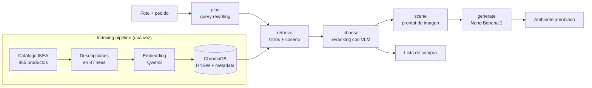
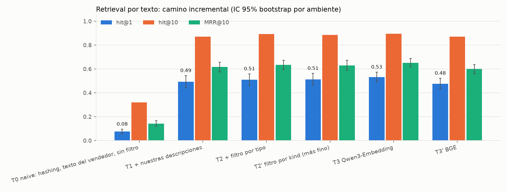
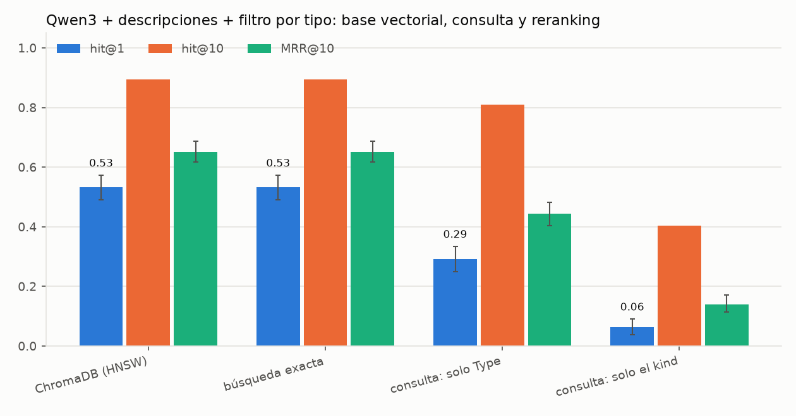

# amoblai

Amoblado virtual con RAG sobre un catálogo real de muebles. Trabajo práctico de 73.69 Large
Language Models (ITBA, 2026).

**Entrada:** una foto del ambiente (y, opcional, otra foto del mismo ambiente desde otro ángulo) y
el pedido en texto libre ("un living nórdico y cálido"). **Salida:** los productos del catálogo
IKEA que hacen falta (lista de compra) y la foto del ambiente con ellos.

## Cómo funciona



| Etapa | Código (`src/amoblai/`) | Qué hace |
|---|---|---|
| Data loading | `dataset/` | Descarga el dataset IKEA fijado a un commit, lo carga con un unpickler restringido y une todo por SKU. |
| Preprocesamiento | `catalog/` | Los productos del alcance (muebles de living, comedor y escritorio, lámparas y decoración) con su tipo, kind y medidas; correcciones y exclusiones a mano. |
| Splitting | `datos/catalogo/descripciones.jsonl` | Un documento por producto (la descripción es corta): ocho líneas fijas (Type, Use, Style, Materials, Colors, Shape, Feel, Goes with), escritas por subagentes mirando la foto. |
| Embedding y base vectorial | `rag/embed.py`, `rag/store.py`, `rag/index.py` | Qwen3-Embedding (local) → ChromaDB: vector, descripción y metadata por producto, índice HNSW en espacio coseno. |
| Pre-retrieval: query rewriting | `furnish/steps.py` (`plan`) | Claude lee la foto y el pedido, decide las piezas (hasta seis: los muebles primero, después lámparas y deco si se pide amoblar), su kind y su tamaño máximo, y escribe el producto ideal en las mismas ocho líneas que el catálogo. |
| Retrieval | `rag/search.py`, `rag/filters.py` | Filtros duros de metadata (kind, medidas) como `where` de ChromaDB, después los k más cercanos por coseno. |
| Post-retrieval: reranking | `furnish/steps.py` (`choose`) | Claude mira la foto y los candidatos de cada pieza y elige la mejor combinación. |
| Generación | `furnish/steps.py` (`scene`), `furnish/image_models.py` | Claude escribe el prompt; el modelo de imagen (Nano Banana 2 por fal, gpt-image o a mano) pone los productos en la foto. |
| Evaluación | `evaluation/` | Métricas sobre los livings y comedores IKEA anotados y las ablaciones de `datos/configs/ablaciones/`. |

## Resultados

Retrieval sobre los 65 livings y comedores de IKEA con productos anotados, con el catálogo
ampliado (855 productos): 552 consultas con respuesta, 199 de muebles (sofás, sillones, sillas,
mesas, alfombras) y 353 de lo que sumó la ampliación (lámparas, deco, guardado, estanterías...).
IC 95% bootstrap por ambiente. Tablas completas en `datos/resultados/reporte/reporte.md`.

| Configuración | hit@1 | hit@10 | MRR@10 |
|---|---|---|---|
| Naive: texto del vendedor, hashing de palabras, sin filtro | 0,076 | 0,319 | 0,143 |
| + nuestras descripciones de ocho líneas | 0,493 | 0,870 | 0,616 |
| **+ Qwen3-Embedding, filtro por tipo, ChromaDB** | **0,533** [0,49–0,57] | 0,895 | **0,651** |
| Azar (con el filtro por tipo) | 0,016 | 0,155 | 0,046 |

- **Por pasada:** en los muebles del primer alcance, hit@1 0,633 (0,636 con el catálogo de 268:
  587 productos más casi no lo mueven); en lo nuevo, 0,476. Por categoría: sillas 0,84,
  muebles de guardado 0,73, mesas 0,69, lámparas 0,59, deco 0,35, alfombras 0,31. Deco y
  alfombras son lo difícil: muchos productos parecidos (53 almohadones, 89 alfombras) y la
  anotación de IKEA no dice cuál de los del ambiente es.
- **Reranking:** con el catálogo de 268 y las consultas de muebles, Opus 5.5 mirando las fotos
  del top-10 subió hit@1 de 0,636 a 0,803 y MRR de 0,737 a 0,847 (US$0,020 por consulta). Sobre
  el catálogo ampliado falta correrlo (`evaluar --estimar`: 367 consultas sin caché).
- **Query rewriting:** con la consulta en las ocho líneas del catálogo, hit@1 da 0,533. Con solo
  la línea Type cae a 0,292, y con solo el nombre del kind (sin reescribir) a 0,063.
- **Base vectorial:** ChromaDB (HNSW) y la búsqueda exacta dan el mismo ranking en las 864
  consultas con filtro por tipo (con filtro por kind, en 863; el primero coincide en todas).
- **Texto contra imagen:** con el mismo ground truth y el catálogo que vio la v0 (275), el
  retrieval por texto da 0,618 de hit@1 y el mejor retrieval por imagen de la v0 (DINOv3), 0,508.




Una corrida completa del flujo cuesta unos US$0,21: plan, choose y scene con Claude Opus 5.5
(US$0,13) y la imagen con Nano Banana 2 (US$0,08). Ejemplo:
`datos/resultados/amoblar/prueba-alvear2/antes_despues.jpg`.

## Instalación

Requisitos: Python 3.11+ y [uv](https://docs.astral.sh/uv/).

```bash
uv sync --extra cpu --group dev --group apps     # sin GPU NVIDIA
uv sync --extra gpu --group dev --group apps     # con GPU NVIDIA (CUDA 12.6)
cp .env.example .env                             # ANTHROPIC_API_KEY, FAL_KEY, OPENAI_API_KEY
```

## Uso

```bash
uv run amoblai data download     # dataset IKEA (Tautkute et al., 2017) en datos/dataset/
uv run amoblai catalogo          # el catálogo: productos, descripciones, kinds, correcciones
uv run amoblai indice            # descripciones → embeddings → ChromaDB (en caché, gratis)
uv run amoblai buscar "Type: armchair, lounge reading chair
Materials: bentwood, leather" --kind armchair

# El flujo completo (se retoma donde quedó; nada se paga dos veces)
uv run amoblai amoblar datos/ambientes_vacios/ambiente2-alvear/alvear2.jpg "un living nórdico y cálido" \
    --vista datos/ambientes_vacios/ambiente2-alvear/alvear1.jpg \
    --set 'budget.allow_paid_steps=[furnish.plan, furnish.choose, furnish.scene]'   # imagen a mano
uv run amoblai amoblar foto.jpg "un comedor para seis" --generador nano_banana_2 --pagar

# Evaluación: cada ablación es un YAML de datos/configs/ablaciones/
uv run amoblai evaluar                                                        # gratis, local
uv run amoblai evaluar --ablacion datos/configs/ablaciones/reranking.yaml --estimar  # cuánto costaría
uv run amoblai evaluar --ablacion datos/configs/ablaciones/reranking.yaml --pagar
uv run amoblai reporte           # tablas y gráficos en datos/resultados/reporte/
uv run amoblai gastos            # lo gastado por cuenta contra sus topes
```

La webapp muestra cada paso del flujo, a medida que se hace:

```bash
uv run --group apps python apps/amoblar.py      # http://127.0.0.1:7860
```

**Costos y topes.** Las llamadas pagas se rechazan salvo que se habiliten (`--pagar`,
`budget.allow_paid` o `budget.allow_paid_steps`) y nunca superan el tope de su cuenta
(`budget.accounts` en `datos/configs/amoblai.yaml`). Cada una queda en
`datos/resultados/gastos.jsonl`. El generador `manual` (default) deja una carpeta con las
imágenes y el prompt para generar a mano en ChatGPT o Gemini.

## Estructura

```
src/amoblai/          el código, un subpaquete por etapa (ver la tabla de arriba)
  paths.py            dónde está cada cosa de datos/
apps/                 la webapp (Gradio)
tests/                pytest sin red: dataset sintético; Claude y fal simulados
datos/
  configs/            amoblai.yaml, categories.yaml, ablaciones/*.yaml
  catalogo/           descripciones (por lote), kinds, correcciones, ikea.yaml
  evaluacion_ikea/    consultas de evaluación sobre los ambientes IKEA
  ambientes_vacios/   fotos de ambientes (dos vistas de cada uno)
  resultados/         corridas del flujo, evaluaciones, reporte, gastos; v0_imagen/
  dataset/ procesados/ cache/    (no se commitean: se regeneran con la CLI)
deprecated/           la v0 (retrieval por imagen), completa
```

## Desarrollo

```bash
uv run pytest
uv run ruff check src tests apps && uv run ruff format --check src tests apps
```

La v0 (retrieval por imagen: Grounding DINO, SAM, DINOv3) sigue en `deprecated/`, con sus
propios tests:

```bash
uv sync --extra cpu --extra imagen --group dev
PYTHONPATH=deprecated uv run pytest -c deprecated/pytest.ini deprecated/tests
PYTHONPATH=deprecated uv run python -m amoblai_imagen.cli --help
```

## Créditos

- **Dataset:** I. Tautkute et al., *What Looks Good with my Sofa: Multimodal Search Engine for
  Interior Design*, FedCSIS 2017 (imágenes de IKEA, uso no comercial).
- **Fotos de ambientes** (`datos/ambientes_vacios/`): departamentos reales, de uso privado. Se
  usan solo para probar el sistema en este repositorio privado; ni ellas ni las imágenes
  generadas a partir de ellas se publican.
