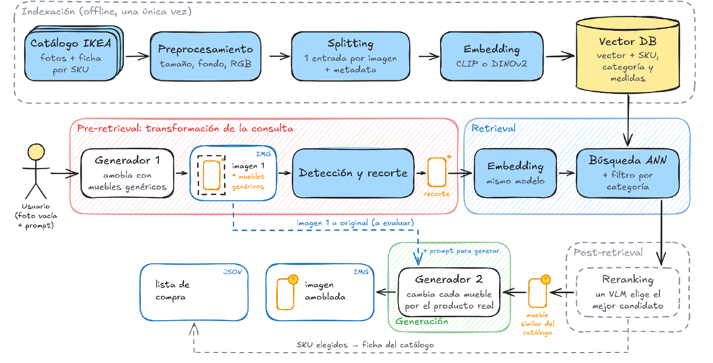
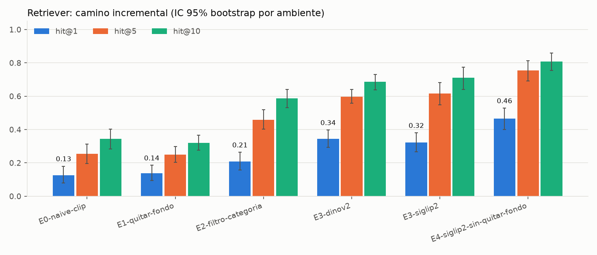

# amoblai

Amoblado virtual con RAG sobre un catálogo real de muebles. Trabajo práctico de
73.69 Large Language Models (ITBA, 2026).

**Entrada:** foto de un ambiente vacío + pedido en texto libre.
**Salida:** la misma foto amoblada con productos reales del catálogo IKEA y la
lista de compra en JSON.

El catálogo funciona como memoria no paramétrica: un generador de imagen amobla
el ambiente con muebles genéricos (pre-retrieval), cada mueble se recorta y se
busca en un índice vectorial de fotos de producto (retrieval con metadata
filtering), y un segundo generador reemplaza cada mueble genérico por el
producto real recuperado. Detalle en [docs/ARQUITECTURA.md](docs/ARQUITECTURA.md).



## Instalación

Requisitos: Python 3.11+ y [uv](https://docs.astral.sh/uv/).

```bash
# Máquina sin GPU NVIDIA (o CI):
uv sync --extra cpu --group dev --group apps
# Máquina con GPU NVIDIA (RTX 3070, wheels CUDA 12.6):
uv sync --extra gpu --group dev --group apps

cp .env.example .env   # completar las claves que se vayan a usar
```

El dispositivo se elige solo (`device: auto`): GPU en fp16 si hay CUDA, si no CPU.
Opcional: `uv sync --extra rembg` para la eliminación de fondo alternativa.

## Datos

```bash
uv run amoblai data download   # dataset IKEA (Tautkute et al., 2017) en data/raw/ikea
uv run amoblai data info       # resumen: productos, imágenes, ambientes por tipo
uv run amoblai categories      # mapeo type → categoría en resultados/mapeo_categorias.md
```

Las imágenes del dataset son de IKEA y solo pueden usarse sin fines
comerciales; nunca se commitean (`data/` está en `.gitignore`).

## Uso

```bash
# 1. Indexing pipeline (una vez por embedder; incremental)
uv run amoblai index                                  # DINOv2 (default)
uv run amoblai index --set embedding.name=clip        # otro embedder

# 2. Evaluación del retriever sobre livings y comedores de IKEA (+ calibra el umbral)
uv run amoblai eval retriever --calibrate

# 3. Amoblar un ambiente
uv run amoblai run ambientes_vacios/living_01.jpg -p "living nórdico, sofá gris y alfombra clara"
#    sin gastar: generadores en dry-run y una foto de IKEA como imagen 1
uv run amoblai run foto.jpg --set budget.dry_run=true \
    --image1 data/raw/ikea/images/room_scenes/<foto>.jpg

# 4. Evaluación de punta a punta sobre ambientes_vacios/
uv run amoblai eval e2e --set generation.gen2_base=original

# 5. Ablación del retriever y reporte
uv run amoblai ablation configs/ablaciones/retriever.yaml
uv run amoblai report                                  # resultados/reporte/
```

Cualquier campo de la config (`configs/base.yaml`, documentado en
`src/amoblai/config.py`) se puede pisar con `--set seccion.campo=valor` o con un
YAML propio que herede con `extends: base.yaml`.

### Generadores y costos

`generation.generator1.provider` y `generation.generator2.provider`:

| Proveedor | Qué hace |
|---|---|
| `manual` (default) | Prepara una carpeta con las imágenes, el prompt e instrucciones, y espera a que se genere la imagen a mano en ChatGPT o Gemini. No gasta API. |
| `openai` | gpt-image por API (`OPENAI_API_KEY`). |
| `gemini` | Modelos de imagen de Gemini por API (`GEMINI_API_KEY`). |
| `dry_run` | No llama a nada: devuelve la base marcada y estima el costo. |

Controles: `budget.dry_run`, `budget.max_calls_per_run`, `budget.max_usd_per_run`,
`budget.max_usd_total` (suma `resultados/gastos.jsonl`). La calidad se elige con
`generation.generatorN.quality` (`low`/`medium` para desarrollo, `high` solo
para las finales). Toda generación se guarda en `resultados/generaciones/`
indexada por un hash de las entradas: repetir una corrida no vuelve a pagar.
Los precios están en `configs/pricing.yaml`.

### Webapps de prueba

Código aparte del núcleo, en `apps/` (ver [apps/README.md](apps/README.md)):

```bash
uv run --group apps python apps/usuario.py      # http://127.0.0.1:7860  vista de usuario
uv run --group apps python apps/flujo.py        # http://127.0.0.1:7861  flujo completo e imágenes intermedias
uv run --group apps python apps/etiquetado.py   # http://127.0.0.1:7862  etiquetado del set estricto
```

### Trazas (opcional)

Con `LANGSMITH_TRACING=true` y `LANGSMITH_API_KEY` en `.env`, cada etapa del
pipeline se registra en LangSmith (sin subir imágenes).

## Resultados

Retriever sobre 65 livings y comedores de IKEA (325 recortes con respuesta,
IC 95% bootstrap por ambiente). Detalle y lecturas en
[docs/EXPERIMENTOS.md](docs/EXPERIMENTOS.md):

| Configuración | hit@1 | hit@10 | MRR@10 |
|---|---|---|---|
| Naive: CLIP, sin quitar fondo, sin filtro | 0,126 | 0,345 | 0,179 |
| DINOv2 + quitar fondo (SAM) + filtro por categoría (default) | 0,345 | 0,686 | 0,452 |
| **SigLIP 2, sin quitar fondo, filtro por categoría (mejor)** | **0,465** | **0,809** | **0,587** |
| Azar (con filtro) | 0,023 | 0,225 | 0,067 |



Cada corrida queda en `resultados/corridas/<fecha>_<tipo>_<nombre>/` con su
config, el commit de git, métricas, imágenes intermedias y costos. El registro
de experimentos está en [docs/EXPERIMENTOS.md](docs/EXPERIMENTOS.md) y las tablas
comparativas en `resultados/reporte/`.

## Estructura

```
configs/            base.yaml, categories.yaml, pricing.yaml, umbrales.yaml, ablaciones/
src/amoblai/
  data/             data loading del dataset IKEA y catálogo por SKU
  indexing/         preprocesamiento, splitting e indexing pipeline
  embeddings/       DINOv2, DINOv3, CLIP, SigLIP 2 (Hugging Face)
  vectorstore/      ChromaDB (coseno)
  vision/           detección, quitar fondo, recortes
  retrieval/        retriever con metadata filtering y umbral; interfaz de reranking
  generation/       generadores (OpenAI, Gemini, manual, dry-run), caché y costos
  pipeline/         pipeline de consulta y lista de compra
  eval/             métricas del retriever, set estricto, e2e, ablación
  report/           tablas y gráficos
  infra/            caché, presupuesto, uso, corridas, dispositivo, trazas
apps/               webapps de prueba (Gradio), separadas del núcleo
ambientes_vacios/   fotos de ambientes vacíos + prompts.yaml
anotaciones/        set estricto etiquetado a mano
resultados/         corridas, generaciones, reportes, gastos (se commitea)
docs/               ARQUITECTURA.md, EXPERIMENTOS.md, propuesta y diagrama
tests/              pytest (dataset sintético, sin red ni modelos)
```

## Desarrollo

```bash
uv run pytest            # tests rápidos (sin modelos)
uv run pytest -m models  # tests que bajan modelos de Hugging Face
uv run ruff check . && uv run ruff format --check .
```

Mejoras fuera del alcance de la v1: [FUTURO.md](FUTURO.md).

## Créditos

Dataset: I. Tautkute et al., *What Looks Good with my Sofa: Multimodal Search
Engine for Interior Design*, FedCSIS 2017. Imágenes propiedad de IKEA, uso no
comercial.
