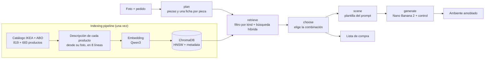

# amoblai

Amoblado virtual con RAG sobre un catálogo real de muebles. Trabajo práctico de 73.69 Large
Language Models (ITBA, 2026).

**Entrada:** una foto del ambiente (y, opcional, otra foto del mismo ambiente desde otro ángulo) y
el pedido en texto libre ("un living nórdico y cálido"). **Salida:** los productos del catálogo
que hacen falta, con cuántas unidades de cada uno (lista de compra), y la foto del ambiente con
ellos. El catálogo junta dos: IKEA (Tautkute et al., 819 productos) y Amazon Berkeley Objects
(683).

## Cómo funciona



En los términos de RAG: la base de conocimiento es el catálogo; la consulta no es el pedido del
usuario sino una ficha por pieza que escribe el plan; lo recuperado son 5 candidatos por pieza; y
hay dos generaciones aumentadas con lo recuperado: la lista (el LLM solo puede elegir entre los
ids recuperados) y la imagen (el modelo de imagen recibe las fotos de los productos elegidos).

| Etapa | Código (`src/amoblai/`) | Qué hace |
|---|---|---|
| Data loading | `dataset/`, `catalog/abo.py` | El dataset IKEA fijado a un commit (se carga con un unpickler restringido y se une todo por SKU) y la selección de listados de Amazon Berkeley Objects. |
| Preprocesamiento: la base de conocimiento | `catalog/` | Los productos del alcance con su tipo, kind y medidas; correcciones y exclusiones a mano. Cada producto se describe **desde su foto** en ocho líneas fijas (Type, Use, Style, Materials, Colors, Shape, Feel, Goes with): IKEA con subagentes de Claude Code, ABO con Opus por la API, mismo formato y misma validación. |
| Splitting | — | No se parte: un producto es un documento (unas 80 palabras). Partirlo por línea empeora; lo que se midió es qué líneas hacen el trabajo. |
| Embedding y base vectorial | `rag/embed.py`, `rag/store.py`, `rag/index.py` | Qwen3-Embedding-0.6B (local, 1024 dimensiones) → ChromaDB: vector, descripción y metadata por producto, índice HNSW en espacio coseno. |
| Pre-retrieval | `furnish/steps.py` (`plan`) | Claude lee la foto y el pedido, lo descompone en piezas y, para cada una, da su kind, su tamaño máximo y **el producto ideal escrito en las mismas ocho líneas que el catálogo**: esa ficha es la consulta (query expansion con respuesta hipotética, HyDE; el pedido nunca se embebe). |
| Retrieval | `rag/search.py`, `rag/filters.py`, `rag/hybrid.py` | Filtros duros de metadata (kind, medidas) y, sobre lo que pasa, **búsqueda híbrida**: el coseno del embedder sobre las descripciones, fusionado con la búsqueda léxica (BM25) y con la foto del producto contra la consulta (SigLIP 2). Los 5 mejores por pieza. Es la versión 2; la versión 1 (`rag.hybrid: []`) es el coseno solo, con los filtros como `where` de ChromaDB. |
| Generación de la lista | `furnish/steps.py` (`choose`) | Claude ve el ambiente y las fotos de los candidatos de todas las piezas y elige una combinación, con cantidades y un porqué. Solo puede elegir ids recuperados: se valida. |
| Generación de la imagen | `furnish/steps.py` (`scene`, `generate`), `furnish/room.py` | Una plantilla (sin LLM) arma el prompt desde la lista; Nano Banana 2 (por fal) recibe la foto y las fotos de los elegidos. Un control (SIFT + RANSAC contra la foto original) descarta la imagen si dejó de ser el mismo cuarto y reintenta, hasta 3 veces. |
| Evaluación | `evaluation/` | El buscador sobre los ambientes IKEA anotados (hit@k, MRR, context precision y recall, diferencias pareadas) y sus ablaciones (`datos/configs/ablaciones/`); el flujo entero sobre ambientes vacíos reales (un juez que compara listas de a pares; diagnóstico sin juez); el generador (faithfulness, answer relevance); la imagen (fidelidad de producto, ambiente preservado). Qué mide cada una y cuánto creerle: `docs/METRICAS.md`. |

## Resultados

Hay dos bancos de prueba y miden cosas distintas. Qué mide cada métrica y cuánto creerle está en
`docs/METRICAS.md`; el registro de experimentos, en `docs/EXPERIMENTOS.md`; y la revisión crítica
del trabajo (qué estaba mal, el ranking de experimentos y lo que falta decidir), en
`docs/REVISION.md`.

- **El buscador, con ground truth.** 64 livings y comedores de IKEA con sus productos anotados.
  Para cada mueble que se ve en la foto hay una consulta (549 con respuesta, sobre el catálogo
  IKEA de 819 productos) y se mira si el producto anotado sale entre los primeros. Es una tarea
  de "producto conocido": quien escribió la consulta veía el mueble. Mide bien el índice; no
  dice cuán buena es la lista para un pedido abierto. IC 95% por bootstrap de ambientes, y cada
  método se compara con otro sobre las mismas consultas (diferencia pareada).
- **El flujo entero, sin ground truth.** 11 ambientes vacíos reales, cada uno con su pedido. Un
  juez (Opus) compara a ciegas las listas de dos configuraciones, en los dos órdenes.

### El buscador: el camino incremental, un cambio por paso

| Paso | hit@1 [IC 95%] | hit@5 | hit@10 | MRR@10 | Cambio en hit@1 (pareado) |
|---|---|---|---|---|---|
| 1. RAG naive: el texto del vendedor embebido, la consulta sin reescribir | 0,109 [0,08–0,14] | 0,299 | 0,439 | 0,194 | |
| 2. + la base que armamos: cada producto descripto desde su foto, en 8 líneas | 0,297 [0,25–0,35] | 0,601 | 0,736 | 0,430 | +0,188 [0,137; 0,237] |
| 3. + la consulta escrita como una ficha del catálogo (respuesta hipotética, HyDE) | 0,535 [0,49–0,58] | 0,811 | 0,885 | 0,652 | +0,239 [0,189; 0,287] |
| 4. + filtro de metadata por kind: **versión 1 del flujo** | 0,530 [0,49–0,57] | 0,790 | 0,863 | 0,641 | −0,005 [−0,015; +0,006] |
| 5. + búsqueda léxica (BM25) fusionada | 0,581 [0,54–0,63] | 0,807 | 0,876 | 0,674 | +0,051 [0,013; 0,088] |
| **6. + la foto del producto (SigLIP 2) fusionada: versión 2, la búsqueda del flujo** | **0,605 [0,56–0,65]** | **0,825** | **0,883** | **0,701** | +0,024 [0,002; 0,045] |
| Azar (con filtro por tipo) | 0,017 | | 0,161 | | |

El flujo le pasa 5 candidatos por pieza al que elige: hit@5 es el número que importa. La versión 1
del flujo buscaba como en el paso 4; la versión 2 (la actual) busca como en el paso 6: +0,075
[0,041; 0,111] de hit@1 y +0,035 [0,013; 0,056] de hit@5 sobre la versión 1.


### Lo que dicen las ablaciones

- **Qué se indexa.** Describir cada producto desde su foto es lo que más pesa: +0,19 con la
  consulta sin reescribir; con la consulta escrita como ficha, el texto del vendedor da 0,120 y
  las descripciones 0,536 (+0,415 [0,368; 0,466]). El texto del vendedor es una frase de
  marketing que no dice cómo es el mueble.
- **Cómo se escribe la consulta** (la técnica de Advanced RAG del paso plan: query expansion con
  respuesta hipotética, más la descomposición del pedido en piezas; `ablaciones/consulta.yaml`).
  Con la búsqueda del flujo, la consulta escrita como una ficha de ocho líneas da hit@1 0,530; la
  misma pieza nombrada en una frase corta, sin reescribir ("square pine coffee table"), 0,324:
  la ficha suma +0,206 [0,157; 0,254] (hit@5 0,790 contra 0,648). Con solo la línea Type, 0,299;
  con solo el nombre del kind, 0,066 (el piso: no dice nada del producto). Un dato que no
  esperábamos: buscando contra la **foto** con SigLIP 2, la frase corta sin reescribir da 0,479,
  casi lo mismo que con la ficha (0,508). La descripción en texto necesita que la consulta hable
  como el catálogo; la foto no.
- **Búsqueda léxica y por foto** (`ablaciones/hibrido.yaml`). Sobre las mismas descripciones,
  BM25 rinde como el embedder (hit@1 0,517 contra 0,530). Y buscar con un modelo de imagen y
  texto (SigLIP 2: la consulta en una frase corta contra la **foto** del producto, sin ninguna
  descripción) también: 0,508, con mejor hit@10 (0,889 contra 0,863). Es la otra ruta para un
  catálogo con fotos (embeber la imagen en vez de pasarla a texto) y llega al mismo lugar; con
  CLIP ViT-B/32 no (0,357). Lo que importa es que **los tres se equivocan en cosas distintas**:
  fusionados (cada puntaje estandarizado, el promedio) dan hit@1 0,605 (+0,075 [0,041; 0,111]
  sobre la búsqueda del flujo), hit@5 0,825 (+0,035 [0,013; 0,056]) y MRR 0,701. Densa + léxica:
  0,581; densa + foto: 0,585; léxica + foto, sin embedder de texto: 0,597. La fusión por puestos
  (RRF) rinde algo menos (0,590). Con las consultas escritas por otros dos redactores la mejora
  se repite: +0,075 y +0,046 de hit@1, +0,035 y +0,048 de hit@5.
- **¿Error, o el mismo mueble en otro color?** hit@1 exige el producto anotado exacto, y el 69% de
  las consultas busca un producto que tiene variantes del mismo modelo en el catálogo. Contando
  como acierto cualquier variante (mismo nombre y grupo), hit@1 sube de 0,530 a 0,623 con la
  versión 1 y de 0,605 a 0,689 con la versión 2: una de cada cinco veces que el primero "falla"
  es el mismo mueble en otra medida u otro color. Y un juez considera que el primero sirve en el
  78% de los casos. El banco subestima el nivel, no cambia el orden entre métodos.
- **El embedder casi no importa en este banco de prueba.** Qwen3 contra una bolsa de palabras:
  +0,026 [−0,025; +0,077] de hit@1, y el mismo hit@10. Solo se sostiene Qwen3 sobre BGE (+0,057
  [0,017; 0,095]). Consultas y descripciones las escribe el mismo modelo con el mismo molde, así
  que contar palabras alcanza. Por familia tampoco se distinguen (`ablaciones/embedders.yaml`).
  Lo que sí suma es fusionarlo con la búsqueda léxica y con la foto. El mejor embedding de OpenAI
  quedó listo para comparar y sin correr (`ablaciones/embedder-openai.yaml`).
- **Los filtros de metadata no suman acá.** Sin filtro y con filtro por tipo dan lo mismo (ninguna
  consulta cambia de primero); el filtro por kind cuesta 2 puntos de hit@5 (−0,020 [−0,037;
  −0,004]), porque a veces la consulta y el catálogo no coinciden en el kind fino (ratona /
  auxiliar). El flujo lo usa igual, por algo que este banco no mide: en los 11 ambientes vacíos,
  con filtro por tipo el 11% de los candidatos sería de otro kind que el pedido (se pide un
  sillón y aparece una silla de comedor). El filtro por medidas actúa poco (cambia 23 de 260 candidatos en los 11 ambientes
  reales, y el 37% de los candidatos no tiene ninguna medida) y no hay evidencia de que mejore
  la lista: el límite lo
  estima el plan a ojo y solo el 34% de los productos de IKEA tiene alguna medida.
- **Elegir con un VLM** (técnica aislada, no un paso del flujo). Opus ordena el top-10 mirando
  las fotos: hit@1 pasa de 0,535 a 0,687 (+0,151 [0,116; 0,188]; US$0,02 por búsqueda). Ordena
  contra la consulta, sin ver el ambiente; el paso `choose` del flujo elige una combinación para
  el cuarto y no tiene ground truth.
- **Cuántos candidatos.** Si el VLM elige entre los primeros k, acierta 0,637 con 3, 0,667 con 5
  y 0,689 con 8; de 3 a 5, +0,029 [0,015; 0,043] (`amoblai evaluar-candidatos`). El techo
  (hit@k) es 0,732, 0,812 y 0,876. El flujo le pasa 5.
- **Un reranker de texto empeora.** Dos cross-encoders locales, que leen la consulta y la
  descripción juntas, reordenando el mismo top-10: el MiniLM de MS MARCO (el de la demo de la
  clase) baja hit@1 de 0,535 a 0,419, y Qwen3-Reranker-0.6B (de la familia del embedder), a 0,474
  (−0,062 [−0,111; −0,013]). Releen el mismo texto que ya usó la búsqueda; el que suma es el
  que mira las fotos.
- **Dimensión del embedding.** Qwen3 truncado (Matryoshka): 0,428 con 32 componentes, 0,506 con
  128, 0,532 con 512, igual que con 1024. Con 1.500 productos la memoria no pesa: queda 1024.
- **Splitting.** No se parte: un producto es un documento. Un chunk por línea da 0,273; comparar
  línea contra línea no se distingue del documento entero (0,514 contra 0,535; +0,022 [−0,018;
  +0,062]). La pregunta de splitting que este problema sí tiene es qué líneas de la
  descripción hacen el trabajo (`ablaciones/lineas.yaml`): sacar Colors cuesta 6 puntos de hit@1
  (−0,057 [−0,082; −0,030]) y sacar Shape, 3; con solo las cuatro líneas de lo que se ve (Type,
  Materials, Colors, Shape) se encuentra igual que con las ocho (0,537 contra 0,530). Las otras
  cuatro están para el pedido abierto, que este banco no mide.
- **Base vectorial.** ChromaDB (HNSW) y la búsqueda exacta dan el mismo ranking en las 864
  consultas. Con 1.500 vectores es lo esperable; ChromaDB da los filtros de metadata en la misma
  consulta y la persistencia.
- **Tres redactores.** Con las consultas escritas tres veces por separado, la búsqueda del flujo
  da hit@1 0,539 ± 0,025 y MRR 0,643 ± 0,015 (la híbrida, 0,604 ± 0,009). Una diferencia de 2
  puntos entre dos métodos no es señal.
- **Por imagen o por texto.** La primera aproximación buscaba por parecido visual entre un
  recorte del mueble y la foto del catálogo (DINOv3). Con la misma unidad (los 232 productos
  anotados): recall@1 0,43 por imagen contra 0,55 por texto (+0,12 [0,04; 0,20]).
- **Relevancia graduada.** Un juez califica el top-3 con 2, 1 o 0 contra la pieza del ambiente
  (150 consultas): el primer candidato sirve en el 78% y alguno del top-3 en el 87%
  (reponderado a la población). El juez le da 2 al anotado el 81% de las veces y a los demás el
  5%: el ground truth es incompleto, hay productos que sirven y no están anotados.
- **Por categoría** (hit@1): sillas 0,84, guardado 0,72, mesas 0,69, lámparas 0,59, deco 0,36,
  alfombras 0,31. Deco y alfombras son lo difícil: muchos productos parecidos (53 almohadones,
  89 alfombras).

### El flujo entero, sobre ambientes vacíos reales

- **Versión 1 contra versión 2** (la búsqueda densa contra la híbrida; mismo plan, mismo juez, 11
  ambientes): la híbrida gana 5, empata 6 y no pierde ninguno (15 votos a 5 de 22; test de
  signos sobre los 5 decididos, p = 0,06). Productos útiles según el juez: 0,74 contra 0,68.
- **Con búsqueda contra sin búsqueda** (los 5 más cercanos contra 5 al azar entre los que pasan
  los mismos filtros; 7 ambientes): 7 a 0, los 14 votos (p = 0,016); productos útiles, 0,82
  contra 0,26. La búsqueda aporta en la tarea real, y el juez lo ve cuando la diferencia es
  grande.
- **RAG contra el catálogo entero en el contexto** (la versión 2 contra el mismo flujo sin
  búsqueda: las 1.502 fichas en el prompt, en texto, con el mismo filtro duro; 11 ambientes):
  5 a 5 y un empate; productos útiles, 0,74 y 0,74. En calidad empatan. El costo depende del
  tráfico: con el catálogo en la caché de prompt, US$0,12 por pedido contra US$0,145 de elegir
  entre candidatos con foto; sin caché, US$1,42. Con 1.500 productos la búsqueda no hace mejor
  la lista: se justifica por escala (el catálogo ya ocupa 341 mil tokens de un contexto de 1
  millón; ABO completo son 147.702 productos), por tráfico y actualización (la caché dura 5
  minutos y cualquier cambio del catálogo la invalida) y porque no ata el sistema a un modelo de
  contexto largo. El producto elegido con todo el catálogo a la vista estaba entre los 5
  candidatos de la búsqueda en 52 de 75 piezas.
- **El piso de ruido** (la versión 2 corrida dos veces, mismo plan y mismos candidatos): el que
  elige cambia 9 de 75 productos entre dos corridas iguales y 5 de las 11 listas salen idénticas.
  El juez dice empate en esas 5 y en las otras 6 elige una, la misma en los dos órdenes: 3 a 3.
  Que una variante "gane un ambiente" no es evidencia por sí solo; lo que cuenta es la asimetría
  (3 a 3 entre corridas iguales; 5 a 0 entre versiones; 7 a 0 contra el azar). Productos útiles:
  0,70 contra 0,72.
- **Qué catálogo.** IKEA + ABO le gana a IKEA solo en 8 ambientes de 11, pierde en 2 y empata
  en 1 (test de signos, p = 0,11); productos útiles, 0,73 contra 0,63. En los 5 pedidos nórdicos
  empatan (2 a 2); en los 6 de otros estilos (industrial, clásico, bohemio...) gana 6 a 0, pero
  esos pedidos los escribimos sabiendo qué le falta a IKEA. ABO solo pierde 4 a 0 con IKEA en
  los nórdicos. Con ABO como distractores, el buscador pierde 3,5 puntos de hit@5 (0,812 →
  0,778). El flujo usa los dos catálogos.
- **Qué hace el que elige** (`amoblai diagnostico-flujo`, sin juez): toma el primero del coseno
  solo el 45% de las veces y el 24% de lo que elige sale de los puestos 4 y 5; nunca dejó una
  pieza afuera (0 de 75), aunque puede: cuando el catálogo no tiene lo pedido, pone lo más
  parecido sin avisar. El 37% de lo elegido no tiene ninguna medida en el catálogo.
- **El generador** (las 11 listas de la versión 2; jueces por la API). Faithfulness del porqué:
  0,88 (313 de 356 afirmaciones se infieren de lo que vio el generador); lo que no se sostiene
  es casi siempre la especie de la madera, que afirma sin verla escrita. Answer relevance: 0,70,
  contra 0,56 de la vara cruzada (los pedidos reconstruidos para otras listas) y 0,40 de pedidos
  sin relación. Sobre otras 11 listas (las del catálogo combinado con la búsqueda de la versión
  1) dan 0,82 y 0,69 contra 0,55: los dos números se repiten, y la diferencia de faithfulness no
  es un efecto de la versión (por ambiente sube en 6 y baja en 5).
- **La imagen** (las 11 listas de la versión 2, con el flujo completo;
  `datos/resultados/amoblar/final-<ambiente>/`): 71 de los 75 productos aparecen, y 31 (41%) se
  reconocen como el producto exacto al comparar su recorte con las fotos del catálogo (DINOv3;
  coseno medio 0,50). El control del ambiente (SIFT + RANSAC contra la foto original) pasa al
  primer intento en 7 de los 11 ambientes; en los otros 4 fallaron los 3 intentos (el modelo
  vuelve a mover la cámara): el control detecta, reintentar con el mismo prompt pocas veces
  arregla. La imagen muestra hasta 13 productos (el modelo acepta 14 imágenes): en el ambiente
  de 15 piezas, dos quedan solo en la lista.
- **La escena: plantilla o LLM** (las mismas 11 listas; `escena-<ambiente>/`). Con el prompt de
  la imagen escrito por Opus mirando el cuarto y los productos, se reconocen 32 de 75 productos
  (31 con la plantilla; pareado por ambiente, −0,014 [−0,103; +0,068]) y el ambiente se conserva
  en 8 de 11 (7 con la plantilla; 6 contra 7 al primer intento). Empate: el flujo usa la
  plantilla, que cuesta US$0,056 menos por pedido y es una llamada menos.
- **Costo.** Una corrida completa cuesta unos US$0,28: plan y choose con Claude Opus 5.5
  (US$0,06 y US$0,14 de media; el choose va de US$0,05 a US$0,43 según cuántas piezas y de qué
  catálogo) y la imagen con Nano Banana 2 (US$0,08 por intento; si el control del ambiente la
  rechaza, se reintenta hasta 3 veces). Sale del registro de cada llamada paga
  (`datos/resultados/gastos.jsonl`; el informe por uso y por día, `datos/resultados/gastos.md`,
  se genera con `amoblai gastos --md`). Ejemplos completos de la configuración final:
  `datos/resultados/amoblar/final-publica-loft-industrial/`, `final-publica-living-japandi/` y
  los otros nueve `final-*`.

### Fuera del RAG: ubicar los muebles (la réplica)

Se tomó un living del ground truth de IKEA, se vació con Nano Banana 2 y se volvió a amoblar con
sus 6 muebles, indicando o no dónde va cada uno. Es un solo cuarto y 3 imágenes por variante: una
prueba, no una medición. Lo que se sostiene: indicar el lugar ayuda mucho. IoU medio con la
posición real: 0,20 sin indicar nada, 0,37 diciéndolo en palabras, 0,40–0,43 con rectángulos
dibujados y 0,48–0,52 con cajas 3D (`evaluation/cajas3d.py`: profundidad de Depth Pro, máscaras
de SAM, piso y pared por RANSAC). Es trabajo futuro: el flujo no tiene las medidas del ambiente.
Resultados en `datos/resultados/replica/living-dagarna/` (US$2,40 de fal).

## Instalación

Requisitos: Python 3.11+ y [uv](https://docs.astral.sh/uv/).

```bash
uv sync --extra cpu --group dev --group apps     # sin GPU NVIDIA
uv sync --extra gpu --group dev --group apps     # con GPU NVIDIA (CUDA 12.6)
cp .env.example .env                             # ANTHROPIC_API_KEY, FAL_KEY, OPENAI_API_KEY
```

## Uso

El repo trae `datos/` completo: el dataset IKEA y ABO, lo procesado, la caché (descripciones,
vectores, ChromaDB, respuestas ya pagadas de Claude) y las fotos. Los dos primeros comandos solo
hacen falta para rehacerlo desde cero.

```bash
uv run amoblai data download     # dataset IKEA (Tautkute et al., 2017) en datos/dataset/
uv run amoblai catalogo          # el catálogo: productos, descripciones, kinds, correcciones
uv run amoblai catalogo-abo      # el catálogo alternativo (ABO): metadata, fotos, selección
                                 #   (--describir --pagar: las descripciones que falten, por la API)
uv run amoblai data ambientes    # las fotos públicas de ambientes vacíos (publicas.yaml)
uv run amoblai indice            # descripciones → embeddings → ChromaDB (en caché, gratis)
uv run amoblai buscar "Type: armchair, lounge reading chair
Materials: bentwood, leather" --kind armchair

# El flujo completo (se retoma donde quedó; nada se paga dos veces). La carpeta de la corrida es
# el nombre de la foto (o --nombre): para otro pedido sobre la misma foto, darle otro --nombre.
uv run amoblai amoblar datos/ambientes_vacios/ambiente2-alvear/alvear2.jpg "un living nórdico y cálido" \
    --vista datos/ambientes_vacios/ambiente2-alvear/alvear1.jpg \
    --set 'budget.allow_paid_steps=[furnish.plan, furnish.choose, furnish.scene]'   # imagen a mano
uv run amoblai amoblar foto.jpg "un comedor para seis" --generador nano_banana_2 --pagar

# Evaluación: cada ablación es un YAML de datos/configs/ablaciones/ (el primer método es la base:
# los demás se comparan con él y con el anterior, con la diferencia pareada y su IC 95%)
uv run amoblai evaluar                                                        # gratis, local
uv run amoblai evaluar --ablacion datos/configs/ablaciones/camino.yaml    # el camino incremental
uv run amoblai evaluar --ablacion datos/configs/ablaciones/consulta.yaml  # la consulta, contra no reescribirla
uv run amoblai evaluar --ablacion datos/configs/ablaciones/hibrido.yaml   # búsqueda léxica, por foto y fusión
uv run amoblai evaluar --ablacion datos/configs/ablaciones/lineas.yaml    # qué líneas de la descripción pesan
uv run amoblai evaluar --ablacion datos/configs/ablaciones/reranking.yaml --estimar  # cuánto costaría
uv run amoblai evaluar --ablacion datos/configs/ablaciones/reranking.yaml --pagar
uv run amoblai evaluar --ablacion datos/configs/ablaciones/reproducibilidad.yaml --replica r2
uv run amoblai evaluar-graduada  # relevancia graduada del top-3 (--armar N: los lotes del juez)
uv run amoblai evaluar-imagen --referencia   # la imagen generada, y la vara con fotos reales
uv run amoblai resumen-imagen <nombre> <corridas>   # los totales de un conjunto de imágenes
uv run amoblai evaluar-candidatos # cuántos candidatos por pieza (sale del reranking ya pago)
uv run amoblai evaluar-respuesta <corridas> --juez opus --pagar   # faithfulness y answer relevance
uv run amoblai diagnostico-flujo # el flujo real sin juez: qué puesto elige, medidas que faltan...
                                 # (--filtro-medidas <variante>: qué cambia el filtro de medidas)
uv run amoblai evaluar-espacio   # el espacio de embeddings: vecinos del mismo kind, UMAP
uv run amoblai evaluar-punta-a-punta datos/configs/punta_a_punta/catalogos.yaml --pagar
                                 # variantes del flujo en ambientes reales, comparadas por un juez
                                 # (hibrida.yaml: versión 1 contra 2; sin_busqueda.yaml: 5 al azar;
                                 # contexto.yaml: el catálogo entero en el prompt; ruido.yaml: la
                                 # misma configuración dos veces)
uv run amoblai evaluar-replica datos/configs/imagen/replica.yaml --pagar
                                 # un ambiente IKEA vaciado y vuelto a amoblar, sin y con cajas
uv run amoblai reporte           # tablas y gráficos en datos/resultados/reporte/
uv run amoblai gastos            # lo gastado por cuenta contra sus topes
```

La webapp muestra cada paso del flujo, a medida que se hace:

```bash
uv run --group apps python apps/amoblar.py      # http://127.0.0.1:7860
```

**Costos y topes.** Las llamadas pagas se rechazan salvo que se habiliten (`--pagar`,
`budget.allow_paid` o `budget.allow_paid_steps`) y nunca superan el tope de su cuenta
(`budget.accounts` en `datos/configs/amoblai.yaml`). Cada una queda en
`datos/resultados/gastos.jsonl`. El generador `manual` (default) deja una carpeta con las
imágenes y el prompt para generar a mano en ChatGPT o Gemini.

## Estructura

```
src/amoblai/          el código, un subpaquete por etapa (ver la tabla de arriba)
  paths.py            dónde está cada cosa de datos/
apps/                 la webapp (Gradio)
tests/                pytest sin red: dataset sintético; Claude y fal simulados
datos/
  configs/            amoblai.yaml, categories.yaml, ablaciones/*.yaml
  catalogo/           descripciones (por lote), kinds, correcciones, ikea.yaml
  evaluacion_ikea/    consultas de evaluación sobre los ambientes IKEA
  ambientes_vacios/   fotos de ambientes (dos vistas de cada uno)
  resultados/         corridas del flujo, evaluaciones, reporte, gastos; v0_imagen/
  dataset/ procesados/ cache/    (se commitean para no bajar ni pagar de nuevo; la CLI los rehace)
deprecated/           el código de la primera aproximación (retrieval por imagen); solo se evaluó su buscador
```

## Desarrollo

```bash
uv run pytest
uv run ruff check src tests apps && uv run ruff format --check src tests apps
```

La primera aproximación (la de la propuesta: generar una imagen amoblada, recortar los muebles
con Grounding DINO y SAM y buscarlos por parecido visual con DINOv3) sigue en `deprecated/`, con
sus propios tests. De ella se construyó y se evaluó el buscador, sobre las fotos de ambientes de
IKEA; nunca corrió de punta a punta. Es la línea de base del retrieval por texto:

```bash
uv sync --extra cpu --extra imagen --group dev
PYTHONPATH=deprecated uv run pytest -c deprecated/pytest.ini deprecated/tests
PYTHONPATH=deprecated uv run python -m amoblai_imagen.cli --help
```

## Créditos

- **Dataset:** I. Tautkute et al., *What Looks Good with my Sofa: Multimodal Search Engine for
  Interior Design*, FedCSIS 2017 (imágenes de IKEA, uso no comercial).
- **Catálogo alternativo:** J. Collins et al., *ABO: Dataset and Benchmarks for Real-World 3D
  Object Understanding*, CVPR 2022 (Amazon Berkeley Objects, CC BY-NC 4.0). Las descripciones
  de los productos las escribió Claude Opus 5.5 mirando cada foto.
- **Fotos de ambientes** (`datos/ambientes_vacios/`): las de `ambiente1` a `ambiente3` son
  departamentos reales, de uso privado. Se usan solo para probar el sistema en este repositorio
  privado; ni ellas ni las imágenes generadas a partir de ellas se publican. Las de `publicas/`
  se bajan con `amoblai data ambientes`: `publicas.yaml` dice de dónde es cada una, su autor y su licencia (Unsplash,
  Pexels o Creative Commons).
