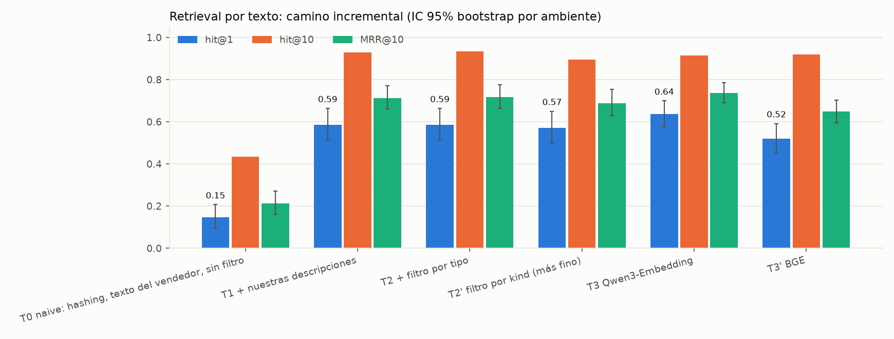
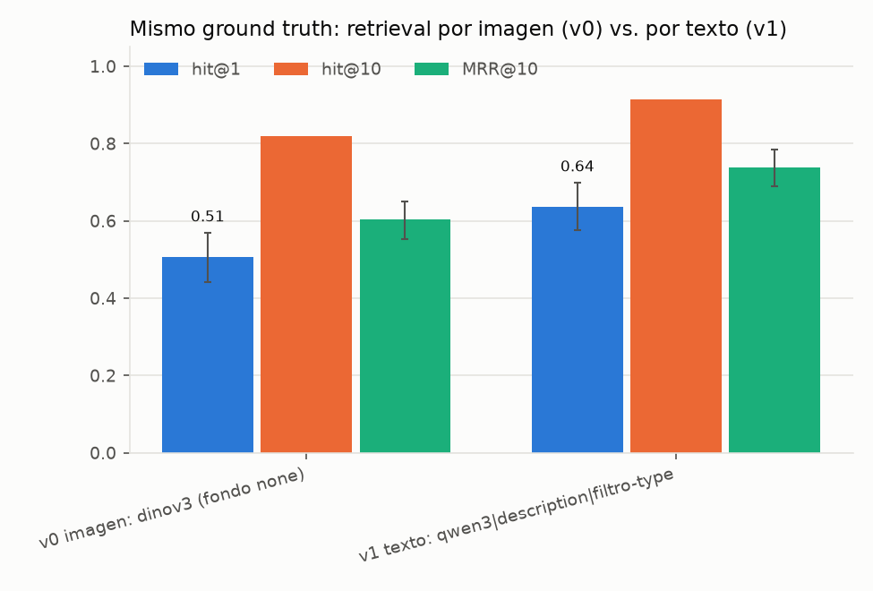

# Retrieval por texto (65 ambientes IKEA)

Corrida: `20261021-141030_ablacion-texto-268`.

| método                             | embedder   | texto            | filtro   |   consultas |   hit@1 | hit@1_ic95     |   hit@3 |   hit@10 |   mrr@10 | mrr@10_ic95    |   recall_item@10 |   azar_hit@1 |
|:-----------------------------------|:-----------|:-----------------|:---------|------------:|--------:|:---------------|--------:|---------:|---------:|:---------------|-----------------:|-------------:|
| hashing|description|filtro-kind    | hashing    | description      | kind     |         198 |  0.5707 | [0.497, 0.650] |  0.7778 |   0.8939 |   0.6882 | [0.629, 0.754] |           0.8447 |       0.0373 |
| hashing|description|filtro-type    | hashing    | description      | type     |         198 |  0.5859 | [0.515, 0.663] |  0.8283 |   0.9343 |   0.716  | [0.664, 0.776] |           0.8835 |       0.0202 |
| hashing|description|filtro-none    | hashing    | description      | none     |         198 |  0.5859 | [0.515, 0.663] |  0.8131 |   0.9293 |   0.7118 | [0.661, 0.772] |           0.8835 |       0.0049 |
| hashing|seller|filtro-kind         | hashing    | seller           | kind     |         198 |  0.202  | [0.136, 0.275] |  0.3434 |   0.6869 |   0.324  | [0.266, 0.387] |           0.6553 |       0.0373 |
| hashing|seller|filtro-type         | hashing    | seller           | type     |         198 |  0.1566 | [0.102, 0.219] |  0.2727 |   0.5505 |   0.2532 | [0.200, 0.312] |           0.5243 |       0.0202 |
| hashing|seller|filtro-none         | hashing    | seller           | none     |         198 |  0.1465 | [0.096, 0.207] |  0.2222 |   0.4343 |   0.213  | [0.162, 0.272] |           0.4175 |       0.0049 |
| bge|description|filtro-kind        | bge        | description      | kind     |         198 |  0.5152 | [0.446, 0.587] |  0.7222 |   0.8939 |   0.634  | [0.578, 0.691] |           0.8544 |       0.0373 |
| bge|description|filtro-type        | bge        | description      | type     |         198 |  0.5202 | [0.452, 0.591] |  0.7475 |   0.9192 |   0.6486 | [0.595, 0.703] |           0.8981 |       0.0202 |
| bge|description|filtro-none        | bge        | description      | none     |         198 |  0.5202 | [0.452, 0.591] |  0.7374 |   0.9192 |   0.6463 | [0.592, 0.701] |           0.8981 |       0.0049 |
| bge|seller|filtro-kind             | bge        | seller           | kind     |         198 |  0.2424 | [0.173, 0.308] |  0.4242 |   0.6667 |   0.3589 | [0.295, 0.420] |           0.6359 |       0.0373 |
| bge|seller|filtro-type             | bge        | seller           | type     |         198 |  0.1919 | [0.137, 0.250] |  0.3687 |   0.5909 |   0.3034 | [0.248, 0.362] |           0.5825 |       0.0202 |
| bge|seller|filtro-none             | bge        | seller           | none     |         198 |  0.1919 | [0.137, 0.250] |  0.3636 |   0.5707 |   0.2992 | [0.243, 0.359] |           0.568  |       0.0049 |
| qwen3|description|filtro-kind      | qwen3      | description      | kind     |         198 |  0.6162 | [0.553, 0.680] |  0.7727 |   0.8788 |   0.7093 | [0.658, 0.764] |           0.835  |       0.0373 |
| qwen3|description|filtro-type      | qwen3      | description      | type     |         198 |  0.6364 | [0.575, 0.699] |  0.8131 |   0.9141 |   0.7374 | [0.689, 0.785] |           0.8932 |       0.0202 |
| qwen3|description|filtro-none      | qwen3      | description      | none     |         198 |  0.6364 | [0.575, 0.699] |  0.8131 |   0.904  |   0.7353 | [0.686, 0.784] |           0.8835 |       0.0049 |
| qwen3|seller|filtro-kind           | qwen3      | seller           | kind     |         198 |  0.2121 | [0.158, 0.266] |  0.4091 |   0.6768 |   0.3398 | [0.283, 0.395] |           0.6456 |       0.0373 |
| qwen3|seller|filtro-type           | qwen3      | seller           | type     |         198 |  0.1667 | [0.118, 0.220] |  0.3182 |   0.6212 |   0.2805 | [0.230, 0.333] |           0.5922 |       0.0202 |
| qwen3|seller|filtro-none           | qwen3      | seller           | none     |         198 |  0.1667 | [0.118, 0.220] |  0.3182 |   0.6061 |   0.2772 | [0.227, 0.331] |           0.5874 |       0.0049 |
| bge|name+description|filtro-kind   | bge        | name+description | kind     |         198 |  0.4848 | [0.419, 0.553] |  0.6919 |   0.8485 |   0.6001 | [0.546, 0.653] |           0.8155 |       0.0373 |
| qwen3|name+description|filtro-kind | qwen3      | name+description | kind     |         198 |  0.5051 | [0.435, 0.580] |  0.7424 |   0.8384 |   0.6233 | [0.569, 0.681] |           0.801  |       0.0373 |

## Texto vs. imagen

| | consultas | hit@1 | hit@10 | MRR@10 |
|---|---|---|---|---|
| v0 imagen (20261006-231131_retriever_abl-retriever-name-dinov3__method-none__category_filter-true) | 325 recortes | 0.508 | 0.819 | 0.603 |
| v1 texto (qwen3|description|filtro-type) | 198 consultas | 0.636 | 0.914 | 0.737 |

