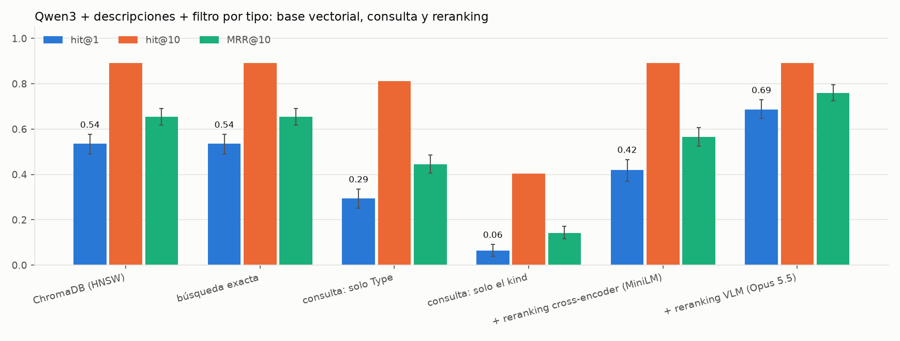
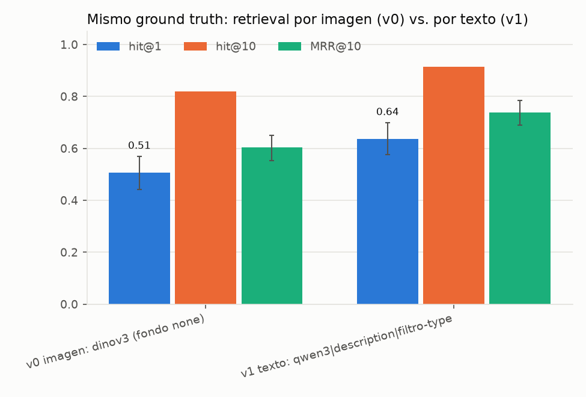

# Retrieval por texto (819 productos, ambientes IKEA)

Corridas: `20261109-235522_ablacion-reranking`, `20261110-003643_ablacion-retrieval`.

| método                                               | corrida                            | embedder   | texto            | filtro   | base   | consulta   | rerank          |   consultas |   hit@1 | hit@1_ic95     |   hit@3 |   hit@10 |   mrr@10 | mrr@10_ic95    |   recall_item@10 |   context_precision@10 |   ndcg@10 |   context_recall@3 |   context_recall@10 |   azar_hit@1 |
|:-----------------------------------------------------|:-----------------------------------|:-----------|:-----------------|:---------|:-------|:-----------|:----------------|------------:|--------:|:---------------|--------:|---------:|---------:|:---------------|-----------------:|-----------------------:|----------:|-------------------:|--------------------:|-------------:|
| qwen3|description|filtro-type|rerank-opus            | 20261109-235522_ablacion-reranking | qwen3      | description      | type     | chroma | full       | opus            |         549 |  0.6867 | [0.648, 0.730] |  0.8142 |   0.8925 |   0.7601 | [0.726, 0.795] |           0.9136 |                 0.7323 |    0.7261 |             0.8718 |              0.9267 |       0.0166 |
| hashing|description|filtro-kind                      | 20261110-003643_ablacion-retrieval | hashing    | description      | kind     | chroma | full       |                 |         549 |  0.5155 | [0.465, 0.568] |  0.7104 |   0.8852 |   0.631  | [0.590, 0.676] |           0.8925 |                 0.6184 |    0.6316 |             0.7424 |              0.9081 |       0.0534 |
| hashing|description|filtro-type                      | 20261110-003643_ablacion-retrieval | hashing    | description      | type     | chroma | full       |                 |         549 |  0.51   | [0.462, 0.561] |  0.7213 |   0.8925 |   0.6341 | [0.595, 0.675] |           0.8906 |                 0.6185 |    0.639  |             0.751  |              0.9092 |       0.0166 |
| hashing|description|filtro-none                      | 20261110-003643_ablacion-retrieval | hashing    | description      | none     | chroma | full       |                 |         549 |  0.4954 | [0.445, 0.548] |  0.7067 |   0.8707 |   0.6184 | [0.579, 0.661] |           0.8791 |                 0.6042 |    0.6181 |             0.7446 |              0.9113 |       0.0018 |
| hashing|seller|filtro-kind                           | 20261110-003643_ablacion-retrieval | hashing    | seller           | kind     | chroma | full       |                 |         549 |  0.173  | [0.140, 0.207] |  0.3807 |   0.7158 |   0.3217 | [0.292, 0.351] |           0.7102 |                 0.3153 |    0.3753 |             0.3787 |              0.7092 |       0.0534 |
| hashing|seller|filtro-type                           | 20261110-003643_ablacion-retrieval | hashing    | seller           | type     | chroma | full       |                 |         549 |  0.1275 | [0.100, 0.156] |  0.286  |   0.5574 |   0.2412 | [0.215, 0.271] |           0.5528 |                 0.2375 |    0.2838 |             0.2983 |              0.5656 |       0.0166 |
| hashing|seller|filtro-none                           | 20261110-003643_ablacion-retrieval | hashing    | seller           | none     | chroma | full       |                 |         549 |  0.0765 | [0.057, 0.096] |  0.1694 |   0.3115 |   0.1423 | [0.119, 0.167] |           0.3148 |                 0.1414 |    0.1595 |             0.2045 |              0.3841 |       0.0018 |
| bge|description|filtro-kind                          | 20261110-003643_ablacion-retrieval | bge        | description      | kind     | chroma | full       |                 |         549 |  0.4754 | [0.427, 0.524] |  0.674  |   0.8488 |   0.5921 | [0.550, 0.633] |           0.8637 |                 0.5771 |    0.5921 |             0.7116 |              0.8884 |       0.0534 |
| bge|description|filtro-type                          | 20261110-003643_ablacion-retrieval | bge        | description      | type     | chroma | full       |                 |         549 |  0.4791 | [0.433, 0.525] |  0.6867 |   0.8707 |   0.6018 | [0.564, 0.639] |           0.8848 |                 0.5845 |    0.6083 |             0.73   |              0.9081 |       0.0166 |
| bge|description|filtro-none                          | 20261110-003643_ablacion-retrieval | bge        | description      | none     | chroma | full       |                 |         549 |  0.4791 | [0.433, 0.525] |  0.6794 |   0.8652 |   0.5996 | [0.561, 0.637] |           0.881  |                 0.5842 |    0.6044 |             0.7292 |              0.914  |       0.0018 |
| bge|seller|filtro-kind                               | 20261110-003643_ablacion-retrieval | bge        | seller           | kind     | chroma | full       |                 |         549 |  0.1894 | [0.153, 0.228] |  0.3953 |   0.6812 |   0.3267 | [0.287, 0.368] |           0.6622 |                 0.3223 |    0.3721 |             0.4169 |              0.6958 |       0.0534 |
| bge|seller|filtro-type                               | 20261110-003643_ablacion-retrieval | bge        | seller           | type     | chroma | full       |                 |         549 |  0.1585 | [0.128, 0.192] |  0.3424 |   0.5556 |   0.2751 | [0.241, 0.313] |           0.5374 |                 0.2713 |    0.3123 |             0.3616 |              0.5757 |       0.0166 |
| bge|seller|filtro-none                               | 20261110-003643_ablacion-retrieval | bge        | seller           | none     | chroma | full       |                 |         549 |  0.133  | [0.108, 0.162] |  0.3024 |   0.5118 |   0.2413 | [0.211, 0.275] |           0.5125 |                 0.2378 |    0.282  |             0.3433 |              0.5676 |       0.0018 |
| qwen3|description|filtro-kind                        | 20261110-003643_ablacion-retrieval | qwen3      | description      | kind     | chroma | full       |                 |         549 |  0.5301 | [0.486, 0.573] |  0.714  |   0.8634 |   0.6407 | [0.602, 0.679] |           0.8848 |                 0.6244 |    0.6308 |             0.7605 |              0.8988 |       0.0534 |
| qwen3|description|filtro-type                        | 20261110-003643_ablacion-retrieval | qwen3      | description      | type     | chroma | full       |                 |         549 |  0.5355 | [0.491, 0.577] |  0.7322 |   0.8925 |   0.6536 | [0.617, 0.690] |           0.9136 |                 0.6315 |    0.6539 |             0.7851 |              0.9267 |       0.0166 |
| qwen3|description|filtro-none                        | 20261110-003643_ablacion-retrieval | qwen3      | description      | none     | chroma | full       |                 |         549 |  0.5355 | [0.491, 0.577] |  0.7304 |   0.8852 |   0.652  | [0.616, 0.688] |           0.9079 |                 0.6319 |    0.6493 |             0.7895 |              0.9306 |       0.0018 |
| qwen3|seller|filtro-kind                             | 20261110-003643_ablacion-retrieval | qwen3      | seller           | kind     | chroma | full       |                 |         549 |  0.153  | [0.128, 0.182] |  0.3224 |   0.6594 |   0.2808 | [0.251, 0.316] |           0.6507 |                 0.2749 |    0.3371 |             0.3474 |              0.6797 |       0.0534 |
| qwen3|seller|filtro-type                             | 20261110-003643_ablacion-retrieval | qwen3      | seller           | type     | chroma | full       |                 |         549 |  0.1257 | [0.102, 0.154] |  0.255  |   0.5537 |   0.2308 | [0.203, 0.262] |           0.5298 |                 0.229  |    0.2777 |             0.2773 |              0.5728 |       0.0166 |
| qwen3|seller|filtro-none                             | 20261110-003643_ablacion-retrieval | qwen3      | seller           | none     | chroma | full       |                 |         549 |  0.1202 | [0.097, 0.145] |  0.2332 |   0.4645 |   0.2053 | [0.178, 0.234] |           0.4607 |                 0.204  |    0.2422 |             0.2586 |              0.5118 |       0.0018 |
| bge|name+description|filtro-kind                     | 20261110-003643_ablacion-retrieval | bge        | name+description | kind     | chroma | full       |                 |         549 |  0.3934 | [0.355, 0.440] |  0.6011 |   0.827  |   0.5214 | [0.486, 0.561] |           0.833  |                 0.5145 |    0.5395 |             0.672  |              0.8578 |       0.0534 |
| qwen3|name+description|filtro-kind                   | 20261110-003643_ablacion-retrieval | qwen3      | name+description | kind     | chroma | full       |                 |         549 |  0.4208 | [0.376, 0.470] |  0.6776 |   0.8434 |   0.5611 | [0.524, 0.600] |           0.858  |                 0.5448 |    0.568  |             0.7283 |              0.8789 |       0.0534 |
| qwen3|description|filtro-type|exact                  | 20261110-003643_ablacion-retrieval | qwen3      | description      | type     | exact  | full       |                 |         549 |  0.5355 | [0.491, 0.577] |  0.7322 |   0.8925 |   0.6536 | [0.617, 0.690] |           0.9136 |                 0.6315 |    0.6539 |             0.7851 |              0.9267 |       0.0166 |
| qwen3|description|filtro-kind|exact                  | 20261110-003643_ablacion-retrieval | qwen3      | description      | kind     | exact  | full       |                 |         549 |  0.5301 | [0.486, 0.573] |  0.714  |   0.8634 |   0.6407 | [0.602, 0.679] |           0.8848 |                 0.6244 |    0.6308 |             0.7605 |              0.8988 |       0.0534 |
| qwen3|description|filtro-type|consulta-type          | 20261110-003643_ablacion-retrieval | qwen3      | description      | type     | chroma | type       |                 |         549 |  0.2933 | [0.250, 0.336] |  0.5392 |   0.8106 |   0.4457 | [0.406, 0.485] |           0.8273 |                 0.4297 |    0.4768 |             0.5799 |              0.8424 |       0.0166 |
| qwen3|description|filtro-type|consulta-kind          | 20261110-003643_ablacion-retrieval | qwen3      | description      | type     | chroma | kind       |                 |         549 |  0.0638 | [0.039, 0.092] |  0.1767 |   0.4044 |   0.1418 | [0.116, 0.172] |           0.334  |                 0.1379 |    0.1707 |             0.1443 |              0.3457 |       0.0166 |
| qwen3|description|filtro-type|dim-32                 | 20261110-003643_ablacion-retrieval | qwen3      | description      | type     | chroma | full       |                 |         549 |  0.4281 | [0.387, 0.472] |  0.6448 |   0.8233 |   0.5553 | [0.520, 0.592] |           0.8503 |                 0.5424 |    0.5626 |             0.6993 |              0.8785 |       0.0166 |
| qwen3|description|filtro-type|dim-64                 | 20261110-003643_ablacion-retrieval | qwen3      | description      | type     | chroma | full       |                 |         549 |  0.4608 | [0.418, 0.504] |  0.6867 |   0.867  |   0.5919 | [0.557, 0.628] |           0.881  |                 0.5749 |    0.6009 |             0.7316 |              0.904  |       0.0166 |
| qwen3|description|filtro-type|dim-128                | 20261110-003643_ablacion-retrieval | qwen3      | description      | type     | chroma | full       |                 |         549 |  0.5064 | [0.463, 0.547] |  0.714  |   0.8852 |   0.6253 | [0.590, 0.661] |           0.9002 |                 0.6056 |    0.6305 |             0.7657 |              0.9195 |       0.0166 |
| qwen3|description|filtro-type|dim-256                | 20261110-003643_ablacion-retrieval | qwen3      | description      | type     | chroma | full       |                 |         549 |  0.5155 | [0.473, 0.556] |  0.7013 |   0.8944 |   0.6334 | [0.598, 0.667] |           0.9136 |                 0.6168 |    0.639  |             0.7508 |              0.9232 |       0.0166 |
| qwen3|description|filtro-type|dim-512                | 20261110-003643_ablacion-retrieval | qwen3      | description      | type     | chroma | full       |                 |         549 |  0.5319 | [0.487, 0.575] |  0.7304 |   0.8925 |   0.649  | [0.613, 0.684] |           0.9136 |                 0.6283 |    0.6493 |             0.7664 |              0.9257 |       0.0166 |
| qwen3|description|filtro-type|chunks-lines-max       | 20261110-003643_ablacion-retrieval | qwen3      | description      | type     | chroma | full       |                 |         549 |  0.2732 | [0.239, 0.309] |  0.5264 |   0.8051 |   0.4335 | [0.407, 0.464] |           0.7927 |                 0.4288 |    0.4733 |             0.5553 |              0.813  |       0.0166 |
| qwen3|description|filtro-type|chunks-lines-aligned   | 20261110-003643_ablacion-retrieval | qwen3      | description      | type     | chroma | full       |                 |         549 |  0.5137 | [0.468, 0.564] |  0.7268 |   0.8907 |   0.6355 | [0.597, 0.675] |           0.9098 |                 0.6181 |    0.6415 |             0.7687 |              0.9252 |       0.0166 |
| qwen3|description|filtro-type|rerank-minilm-reranker | 20261110-003643_ablacion-retrieval | qwen3      | description      | type     | chroma | full       | minilm-reranker |         549 |  0.4189 | [0.369, 0.466] |  0.6521 |   0.8925 |   0.5651 | [0.525, 0.606] |           0.9136 |                 0.5453 |    0.591  |             0.6933 |              0.9267 |       0.0166 |

## hit@1 por categoría

| método | armchair (18) | bench (4) | cabinet (39) | chair (45) | deco (207) | dresser (1) | lamp (64) | ottoman (6) | rug (45) | shelf (21) | sofa (24) | stool (8) | table (67) |
|---|---|---|---|---|---|---|---|---|---|---|---|---|---|
| hashing|description|filtro-kind | 0.67 | 1.00 | 0.74 | 0.67 | 0.34 | 1.00 | 0.67 | 0.83 | 0.36 | 0.48 | 0.38 | 1.00 | 0.69 |
| hashing|description|filtro-type | 0.67 | 1.00 | 0.79 | 0.67 | 0.33 | 1.00 | 0.58 | 0.83 | 0.36 | 0.48 | 0.38 | 1.00 | 0.73 |
| hashing|description|filtro-none | 0.67 | 0.75 | 0.79 | 0.67 | 0.32 | 0.00 | 0.56 | 0.67 | 0.36 | 0.43 | 0.33 | 0.88 | 0.73 |
| hashing|seller|filtro-kind | 0.17 | 0.25 | 0.18 | 0.22 | 0.15 | 0.00 | 0.11 | 0.33 | 0.07 | 0.19 | 0.25 | 0.38 | 0.27 |
| hashing|seller|filtro-type | 0.11 | 0.25 | 0.13 | 0.22 | 0.11 | 0.00 | 0.06 | 0.33 | 0.07 | 0.14 | 0.21 | 0.12 | 0.16 |
| hashing|seller|filtro-none | 0.06 | 0.00 | 0.08 | 0.20 | 0.06 | 0.00 | 0.05 | 0.00 | 0.07 | 0.05 | 0.08 | 0.12 | 0.10 |
| bge|description|filtro-kind | 0.56 | 1.00 | 0.59 | 0.62 | 0.34 | 1.00 | 0.61 | 0.67 | 0.18 | 0.43 | 0.54 | 1.00 | 0.64 |
| bge|description|filtro-type | 0.50 | 1.00 | 0.62 | 0.62 | 0.34 | 1.00 | 0.61 | 0.67 | 0.18 | 0.43 | 0.54 | 1.00 | 0.67 |
| bge|description|filtro-none | 0.50 | 1.00 | 0.62 | 0.62 | 0.34 | 1.00 | 0.61 | 0.67 | 0.18 | 0.43 | 0.54 | 1.00 | 0.67 |
| bge|seller|filtro-kind | 0.17 | 0.75 | 0.21 | 0.33 | 0.14 | 0.00 | 0.12 | 0.00 | 0.07 | 0.10 | 0.25 | 0.62 | 0.31 |
| bge|seller|filtro-type | 0.11 | 0.75 | 0.18 | 0.29 | 0.14 | 0.00 | 0.08 | 0.00 | 0.07 | 0.10 | 0.21 | 0.38 | 0.22 |
| bge|seller|filtro-none | 0.11 | 0.25 | 0.15 | 0.29 | 0.10 | 0.00 | 0.08 | 0.00 | 0.07 | 0.10 | 0.21 | 0.38 | 0.19 |
| qwen3|description|filtro-kind | 0.72 | 1.00 | 0.69 | 0.84 | 0.37 | 1.00 | 0.61 | 1.00 | 0.31 | 0.43 | 0.58 | 0.88 | 0.64 |
| qwen3|description|filtro-type | 0.72 | 1.00 | 0.72 | 0.84 | 0.36 | 1.00 | 0.59 | 1.00 | 0.31 | 0.43 | 0.62 | 0.88 | 0.69 |
| qwen3|description|filtro-none | 0.72 | 1.00 | 0.72 | 0.84 | 0.36 | 1.00 | 0.59 | 1.00 | 0.31 | 0.43 | 0.62 | 0.88 | 0.69 |
| qwen3|seller|filtro-kind | 0.11 | 0.75 | 0.13 | 0.44 | 0.08 | 1.00 | 0.14 | 0.00 | 0.04 | 0.24 | 0.17 | 0.25 | 0.21 |
| qwen3|seller|filtro-type | 0.11 | 0.75 | 0.13 | 0.38 | 0.08 | 1.00 | 0.06 | 0.00 | 0.04 | 0.24 | 0.12 | 0.12 | 0.13 |
| qwen3|seller|filtro-none | 0.11 | 0.75 | 0.13 | 0.38 | 0.08 | 1.00 | 0.06 | 0.00 | 0.04 | 0.19 | 0.12 | 0.00 | 0.13 |
| bge|name+description|filtro-kind | 0.39 | 1.00 | 0.38 | 0.58 | 0.27 | 1.00 | 0.42 | 0.83 | 0.22 | 0.24 | 0.46 | 0.88 | 0.63 |
| qwen3|name+description|filtro-kind | 0.72 | 0.50 | 0.41 | 0.64 | 0.32 | 1.00 | 0.44 | 0.67 | 0.22 | 0.33 | 0.46 | 0.88 | 0.55 |
| qwen3|description|filtro-type|exact | 0.72 | 1.00 | 0.72 | 0.84 | 0.36 | 1.00 | 0.59 | 1.00 | 0.31 | 0.43 | 0.62 | 0.88 | 0.69 |
| qwen3|description|filtro-kind|exact | 0.72 | 1.00 | 0.69 | 0.84 | 0.37 | 1.00 | 0.61 | 1.00 | 0.31 | 0.43 | 0.58 | 0.88 | 0.64 |
| qwen3|description|filtro-type|consulta-type | 0.22 | 0.50 | 0.26 | 0.69 | 0.23 | 0.00 | 0.27 | 0.50 | 0.13 | 0.29 | 0.17 | 0.75 | 0.36 |
| qwen3|description|filtro-type|consulta-kind | 0.06 | 0.00 | 0.05 | 0.07 | 0.11 | 0.00 | 0.00 | 0.00 | 0.00 | 0.00 | 0.00 | 0.25 | 0.06 |
| qwen3|description|filtro-type|dim-32 | 0.44 | 1.00 | 0.56 | 0.78 | 0.30 | 1.00 | 0.41 | 0.50 | 0.20 | 0.24 | 0.50 | 1.00 | 0.60 |
| qwen3|description|filtro-type|dim-64 | 0.67 | 0.75 | 0.69 | 0.76 | 0.29 | 1.00 | 0.45 | 0.83 | 0.29 | 0.38 | 0.46 | 1.00 | 0.61 |
| qwen3|description|filtro-type|dim-128 | 0.72 | 1.00 | 0.72 | 0.76 | 0.33 | 1.00 | 0.55 | 0.83 | 0.29 | 0.43 | 0.58 | 1.00 | 0.69 |
| qwen3|description|filtro-type|dim-256 | 0.72 | 1.00 | 0.72 | 0.80 | 0.35 | 1.00 | 0.59 | 0.83 | 0.27 | 0.43 | 0.58 | 0.88 | 0.66 |
| qwen3|description|filtro-type|dim-512 | 0.72 | 1.00 | 0.74 | 0.84 | 0.35 | 1.00 | 0.58 | 1.00 | 0.31 | 0.43 | 0.58 | 0.88 | 0.70 |
| qwen3|description|filtro-type|chunks-lines-max | 0.33 | 0.75 | 0.21 | 0.36 | 0.19 | 1.00 | 0.41 | 0.83 | 0.11 | 0.33 | 0.17 | 0.75 | 0.36 |
| qwen3|description|filtro-type|chunks-lines-aligned | 0.78 | 1.00 | 0.74 | 0.82 | 0.35 | 1.00 | 0.38 | 0.67 | 0.33 | 0.48 | 0.62 | 1.00 | 0.73 |
| qwen3|description|filtro-type|rerank-minilm-reranker | 0.50 | 0.75 | 0.59 | 0.62 | 0.33 | 1.00 | 0.48 | 0.50 | 0.16 | 0.33 | 0.29 | 0.62 | 0.57 |

## Por pasada de consultas (v1: muebles del primer alcance; v2: la ampliación)

| método | consultas_ambiente_v1 hit@1 / MRR | consultas_ambiente_v2 hit@1 / MRR |
|---|---|---|
| hashing|description|filtro-kind | 0.568 / 0.687 (199) | 0.486 / 0.599 (350) |
| hashing|description|filtro-type | 0.583 / 0.715 (199) | 0.469 / 0.588 (350) |
| hashing|description|filtro-none | 0.578 / 0.703 (199) | 0.449 / 0.570 (350) |
| hashing|seller|filtro-kind | 0.201 / 0.323 (199) | 0.157 / 0.321 (350) |
| hashing|seller|filtro-type | 0.156 / 0.250 (199) | 0.111 / 0.236 (350) |
| hashing|seller|filtro-none | 0.111 / 0.162 (199) | 0.057 / 0.131 (350) |
| bge|description|filtro-kind | 0.513 / 0.632 (199) | 0.454 / 0.569 (350) |
| bge|description|filtro-type | 0.518 / 0.647 (199) | 0.457 / 0.576 (350) |
| bge|description|filtro-none | 0.518 / 0.643 (199) | 0.457 / 0.575 (350) |
| bge|seller|filtro-kind | 0.241 / 0.358 (199) | 0.160 / 0.309 (350) |
| bge|seller|filtro-type | 0.191 / 0.295 (199) | 0.140 / 0.264 (350) |
| bge|seller|filtro-none | 0.181 / 0.281 (199) | 0.106 / 0.219 (350) |
| qwen3|description|filtro-kind | 0.613 / 0.708 (199) | 0.483 / 0.602 (350) |
| qwen3|description|filtro-type | 0.633 / 0.736 (199) | 0.480 / 0.607 (350) |
| qwen3|description|filtro-none | 0.633 / 0.733 (199) | 0.480 / 0.606 (350) |
| qwen3|seller|filtro-kind | 0.211 / 0.339 (199) | 0.120 / 0.248 (350) |
| qwen3|seller|filtro-type | 0.166 / 0.278 (199) | 0.103 / 0.204 (350) |
| qwen3|seller|filtro-none | 0.166 / 0.269 (199) | 0.094 / 0.169 (350) |
| bge|name+description|filtro-kind | 0.482 / 0.598 (199) | 0.343 / 0.478 (350) |
| qwen3|name+description|filtro-kind | 0.502 / 0.623 (199) | 0.374 / 0.526 (350) |
| qwen3|description|filtro-type|exact | 0.633 / 0.736 (199) | 0.480 / 0.607 (350) |
| qwen3|description|filtro-kind|exact | 0.613 / 0.708 (199) | 0.483 / 0.602 (350) |
| qwen3|description|filtro-type|consulta-type | 0.347 / 0.503 (199) | 0.263 / 0.413 (350) |
| qwen3|description|filtro-type|consulta-kind | 0.040 / 0.081 (199) | 0.077 / 0.176 (350) |
| qwen3|description|filtro-type|dim-32 | 0.523 / 0.642 (199) | 0.374 / 0.506 (350) |
| qwen3|description|filtro-type|dim-64 | 0.558 / 0.675 (199) | 0.406 / 0.544 (350) |
| qwen3|description|filtro-type|dim-128 | 0.603 / 0.710 (199) | 0.451 / 0.577 (350) |
| qwen3|description|filtro-type|dim-256 | 0.598 / 0.712 (199) | 0.469 / 0.589 (350) |
| qwen3|description|filtro-type|dim-512 | 0.633 / 0.733 (199) | 0.474 / 0.602 (350) |
| qwen3|description|filtro-type|chunks-lines-max | 0.276 / 0.454 (199) | 0.271 / 0.422 (350) |
| qwen3|description|filtro-type|chunks-lines-aligned | 0.653 / 0.747 (199) | 0.434 / 0.572 (350) |
| qwen3|description|filtro-type|rerank-minilm-reranker | 0.447 / 0.591 (199) | 0.403 / 0.550 (350) |

## Base vectorial, query rewriting y reranking

## ¿Cuántos candidatos? La curva de hit@k

| método | k=1 | k=2 | k=3 | k=5 | k=10 | k=15 | k=20 | k=30 | k=50 |
|---|---|---|---|---|---|---|---|---|---|
| Qwen3, filtro por tipo | 0.535 | 0.674 | 0.732 | 0.812 | 0.892 | 0.933 | 0.958 | 0.980 | 0.995 |
| BGE, filtro por tipo | 0.479 | 0.612 | 0.687 | 0.760 | 0.871 | 0.913 | 0.953 | 0.980 | 0.995 |
| hashing, filtro por tipo | 0.510 | 0.647 | 0.721 | 0.809 | 0.892 | 0.920 | 0.936 | 0.969 | 0.989 |

## Dimensión del embedding (Matryoshka)

| dimensión | bytes por vector | hit@1 | hit@10 | MRR@10 |
|---|---|---|---|---|
| 32 | 128 | 0.428 | 0.823 | 0.555 |
| 64 | 256 | 0.461 | 0.867 | 0.592 |
| 128 | 512 | 0.506 | 0.885 | 0.625 |
| 256 | 1024 | 0.515 | 0.894 | 0.633 |
| 512 | 2048 | 0.532 | 0.892 | 0.649 |
| 1024 | 4096 | 0.535 | 0.892 | 0.654 |

## Splitting: ¿un documento por producto o un chunk por línea?

| splitting | hit@1 | hit@10 | MRR@10 |
|---|---|---|---|
| un documento por producto (ChromaDB) | 0.535 [0.49–0.58] | 0.892 | 0.654 |
| cada línea un chunk, el producto vale su mejor línea | 0.273 [0.24–0.31] | 0.805 | 0.433 |
| línea contra línea del mismo rótulo, promedio | 0.514 [0.47–0.56] | 0.891 | 0.635 |

## Reproducibilidad: tres escrituras independientes de las consultas

La búsqueda es determinística: lo que varía es quién escribe la consulta (en el flujo, el paso plan). Las mismas fotos y los mismos prompts, tres subagentes distintos por lote. Promedio ± desvío estándar (n=3) y el rango.

| método | consultas (r1/r2/r3) | hit@1 | MRR@10 | hit@10 |
|---|---|---|---|---|
| bge|description|filtro-type | 549/550/550 | 0.489 ± 0.015 (0.479–0.505) | 0.610 ± 0.008 (0.602–0.618) | 0.873 ± 0.002 (0.871–0.875) |
| hashing|description|filtro-none | 549/550/550 | 0.497 ± 0.025 (0.473–0.522) | 0.619 ± 0.019 (0.600–0.637) | 0.867 ± 0.016 (0.849–0.880) |
| hashing|description|filtro-type | 549/550/550 | 0.513 ± 0.027 (0.487–0.542) | 0.635 ± 0.021 (0.615–0.656) | 0.886 ± 0.010 (0.875–0.892) |
| hashing|seller|filtro-none | 549/550/550 | 0.075 ± 0.002 (0.073–0.076) | 0.139 ± 0.003 (0.136–0.142) | 0.317 ± 0.009 (0.311–0.327) |
| qwen3|description|filtro-kind | 549/550/550 | 0.537 ± 0.024 (0.518–0.564) | 0.642 ± 0.015 (0.627–0.657) | 0.867 ± 0.004 (0.863–0.871) |
| qwen3|description|filtro-type | 549/550/550 | 0.545 ± 0.026 (0.525–0.575) | 0.656 ± 0.017 (0.640–0.674) | 0.898 ± 0.006 (0.892–0.904) |

## La imagen generada

Fidelidad: cada producto de la lista buscado en la imagen final (Grounding DINO), recortado y comparado con su foto del catálogo (DINOv3); *identificado* = el más parecido al recorte entre los productos de su tipo es él. Ambiente: SSIM fuera de los muebles y fracción de puntos SIFT de la foto original reencontrados (RANSAC). Pedido: SigLIP 2 entre el pedido y la imagen final, menos lo mismo con la foto vacía; puesto del pedido real entre él y seis pedidos de contraste.

| corrida | generador | detectados | identificados@1 | coseno | inventadas | SSIM fuera | SIFT | pedido Δ (puesto) |
|---|---|---|---|---|---|---|---|---|
| experimento | nano_banana_2 | 6/6 | 0.6667 | 0.5342 | 1 | 0.8291 | 0.1329 | +0.061 (1/7) |
| experimento-buen-pedido | nano_banana_2 | 9/9 | 0.4444 | 0.3649 | 0 | 0.2899 | 0.0065 | +0.085 (1/7) |
| experimento-buen-pedido-estricto | nano_banana_2 | 9/9 | 0.4444 | 0.4291 | 1 | 0.7817 | 0.0759 | +0.063 (1/7) |
| experimento-libre | nano_banana_2 | 6/6 | 0.5 | 0.4561 | 0 | 0.8087 | 0.1008 | +0.075 (1/7) |
| experimento-libre-modular | nano_banana_2 | 6/6 | 0.5 | 0.4655 | 0 | 0.7666 | 0.1126 | +0.090 (1/7) |
| prueba-alvear2 | nano_banana_2 | 4/4 | 0.75 | 0.6824 | 0 | 0.9747 | 0.5521 | +0.077 (1/7) |

### `experimento` por producto

| producto | kind | puesto | coseno |
|---|---|---|---|
| 703.233.51 | bookcase | 1/63 | 0.7967 |
| 391.505.88 | armchair | 1/78 | 0.8509 |
| 402.712.59 | rug | 9/89 | 0.1819 |
| 302.865.67 | floor lamp | 1/102 | 0.2782 |
| 102.397.13 | side table | 1/71 | 0.6031 |
| 802.841.94 | curtains | 10/255 | 0.4941 |

### `experimento-buen-pedido` por producto

| producto | kind | puesto | coseno |
|---|---|---|---|
| 802.456.40 | bookcase | 2/54 | 0.2216 |
| 391.505.88 | armchair | 3/78 | 0.6233 |
| 302.865.67 | floor lamp | 1/101 | 0.3698 |
| 802.972.43 | side table | 1/71 | 0.4326 |
| 832.351.10 | rug | 1/89 | 0.3925 |
| 302.006.96 | throw | 60/244 | 0.0908 |
| 503.265.29 | cushion | 25/244 | 0.1644 |
| 802.841.94 | curtains | 9/244 | 0.3017 |
| 001.185.23 | plant | 1/244 | 0.6875 |

### `experimento-buen-pedido-estricto` por producto

| producto | kind | puesto | coseno |
|---|---|---|---|
| 802.456.40 | bookcase | 1/54 | 0.42 |
| 391.505.88 | armchair | 1/78 | 0.6653 |
| 302.865.67 | floor lamp | 2/101 | 0.3725 |
| 802.972.43 | side table | 2/71 | 0.3639 |
| 832.351.10 | rug | 1/89 | 0.5121 |
| 302.006.96 | throw | 142/244 | 0.0458 |
| 503.265.29 | cushion | 23/244 | 0.2299 |
| 802.841.94 | curtains | 5/244 | 0.5744 |
| 001.185.23 | plant | 1/244 | 0.6783 |

### `experimento-libre` por producto

| producto | kind | puesto | coseno |
|---|---|---|---|
| 703.233.51 | bookcase | 3/54 | 0.4892 |
| 391.505.88 | armchair | 1/78 | 0.7 |
| 402.712.59 | rug | 51/89 | 0.0488 |
| 302.865.67 | floor lamp | 1/101 | 0.5495 |
| 102.397.13 | side table | 1/71 | 0.5383 |
| 802.841.94 | curtains | 4/244 | 0.4106 |

### `experimento-libre-modular` por producto

| producto | kind | puesto | coseno |
|---|---|---|---|
| 703.233.51 | bookcase | 1/54 | 0.4612 |
| 391.505.88 | armchair | 1/78 | 0.827 |
| 402.712.59 | rug | 18/89 | 0.0917 |
| 302.865.67 | floor lamp | 1/101 | 0.3085 |
| 102.397.13 | side table | 2/71 | 0.5379 |
| 802.841.94 | curtains | 7/244 | 0.5666 |

### `prueba-alvear2` por producto

| producto | kind | puesto | coseno |
|---|---|---|---|
| 691.249.46 | sofa | 7/37 | 0.6662 |
| 391.505.88 | armchair | 1/78 | 0.8996 |
| 002.852.58 | rug | 1/89 | 0.2853 |
| 302.397.12 | coffee table | 1/71 | 0.8785 |

### La vara: la misma identificación con fotos reales (ambientes IKEA)

545 recortes de 64 ambientes: hit@1 0.444 [0.39–0.50], MRR@10 0.556, coseno medio 0.411.

| grupo | hit@1 | recortes |
|---|---|---|
| armchair | 0.80 | 5 |
| bench | 1.00 | 2 |
| cabinet | 0.62 | 47 |
| chair | 0.75 | 122 |
| curtains | 0.11 | 27 |
| cushion | 0.24 | 95 |
| desk | 0.00 | 1 |
| floor lamp | 0.44 | 18 |
| mirror | 0.33 | 3 |
| ottoman | 0.67 | 3 |
| pendant lamp | 0.44 | 18 |
| plant | 0.10 | 20 |
| rug | 0.30 | 54 |
| shelf | 0.14 | 21 |
| sofa | 0.48 | 29 |
| stool | 0.73 | 11 |
| table | 0.75 | 16 |
| vase | 0.50 | 10 |
| wall art | 0.26 | 43 |

## Relevancia graduada del top-3 (juez)

Método `qwen3|description|filtro-type`. Un juez (subagente) califica cada uno de los tres primeros candidatos contra la pieza que se ve en el ambiente: 2 el mismo o indistinguible, 1 una alternativa aceptable, 0 no sirve. *útil@k*: alguno de los k primeros con 1 o 2.

| consultas | n | nota del 1.º | útil@1 | útil@3 | un 2 en el top-3 | NDCG@3 |
|---|---|---|---|---|---|---|
| todas | 150 | 1.07 | 0.747 [0.68–0.82] | 0.840 [0.78–0.89] | 0.427 | 0.783 |
| con anotado | 75 | 1.41 | 0.867 [0.78–0.94] | 0.947 [0.89–0.99] | 0.693 | 0.884 |
| sin anotado | 75 | 0.73 | 0.627 [0.51–0.73] | 0.733 [0.63–0.83] | 0.160 | 0.682 |

Acuerdo con el ground truth: de 59 productos anotados que aparecen en el top-3, el juez le dio 2 al 81%; a los demás candidatos, al 5%.

## La respuesta en texto: faithfulness y answer relevance (RAGAS)

Faithfulness: de las afirmaciones de hecho del porqué de cada producto, cuántas se infieren de lo que vio el sistema (pedido, foto del ambiente, foto, descripción y medida de cada producto). Answer relevance: coseno medio (Qwen3) entre el pedido original y tres pedidos que un juez que no lo vio infiere de la respuesta; la vara es el mismo coseno con pedidos de contraste. Jueces: subagentes de Claude Code.

| corrida | afirmaciones | faithfulness | answer relevance | vara | no sostenidas |
|---|---|---|---|---|---|
| experimento | 34 | 0.9706 | 0.6038 | 0.3951 | It is the only round rug available |
| prueba-alvear | 27 | 0.8889 | 0.6901 | 0.3743 | The floor is oak; The rug is the largest option; The rug reaches under the sofa's front legs, the table and the armchair |
| prueba-alvear2 | 25 | 0.96 | 0.7261 | 0.3743 | The rug is large enough to sit under the front of both the sofa and the armchair |
| prueba-alvear2-scene-v2 | 26 | 0.9231 | 0.7158 | 0.3743 | The rug is large enough to go under the front of both the sofa and the armchair; The table's size suits a three-seat sofa |

## El espacio de embeddings

855 descripciones. Separabilidad: de cada producto, ¿su vecino más cercano es de su mismo kind / tipo?, y el silhouette por kind (coseno).

| embedder | vecino del mismo kind | vecino del mismo tipo | silhouette por kind |
|---|---|---|---|
| hashing | 0.834 | 0.910 | 0.076 |
| bge | 0.918 | 0.964 | 0.222 |
| qwen3 | 0.894 | 0.961 | 0.179 |

| consulta | mejor coseno | coseno del 10.º | kinds del top-10 |
|---|---|---|---|
| del dominio | 0.833 | 0.751 | armchair, armchair, armchair, ottoman, armchair, sofa, sofa, armchair, armchair, armchair |
| fuera del dominio | 0.318 | 0.283 | floor lamp, desk, desk lamp, rug, rug, desk lamp, armchair, low stool, desk lamp, sofa |

## Texto vs. imagen

| | consultas | hit@1 | hit@10 | MRR@10 |
|---|---|---|---|---|
| v0 imagen (20261006-231131_retriever_abl-retriever-name-dinov3__method-none__category_filter-true) | 325 recortes | 0.508 | 0.819 | 0.603 |
| v1 texto (qwen3|description|filtro-type) | 207 consultas | 0.618 | 0.908 | 0.717 |

## Corridas anteriores (otro catálogo u otras consultas)

No se mezclan con las de arriba: cambian el universo de búsqueda o las consultas.

### `20261021-133226_ablacion-texto` (275 productos)

| método                             |   consultas |   hit@1 |   hit@10 |   mrr@10 |
|:-----------------------------------|------------:|--------:|---------:|---------:|
| hashing|description|filtro-kind    |         207 |  0.5459 |   0.8937 |   0.6698 |
| hashing|description|filtro-type    |         207 |  0.5604 |   0.9324 |   0.6963 |
| hashing|description|filtro-none    |         207 |  0.5604 |   0.9275 |   0.6924 |
| hashing|seller|filtro-kind         |         207 |  0.1932 |   0.6957 |   0.3144 |
| hashing|seller|filtro-type         |         207 |  0.1546 |   0.5604 |   0.2469 |
| hashing|seller|filtro-none         |         207 |  0.1449 |   0.4396 |   0.2083 |
| bge|description|filtro-kind        |         207 |  0.4976 |   0.8937 |   0.6197 |
| bge|description|filtro-type        |         207 |  0.5024 |   0.9179 |   0.6337 |
| bge|description|filtro-none        |         207 |  0.5024 |   0.9179 |   0.6315 |
| bge|seller|filtro-kind             |         207 |  0.2367 |   0.6473 |   0.3476 |
| bge|seller|filtro-type             |         207 |  0.1884 |   0.5749 |   0.2946 |
| bge|seller|filtro-none             |         207 |  0.1884 |   0.5556 |   0.2905 |
| qwen3|description|filtro-kind      |         207 |  0.599  |   0.8744 |   0.6903 |
| qwen3|description|filtro-type      |         207 |  0.6184 |   0.9082 |   0.7172 |
| qwen3|description|filtro-none      |         207 |  0.6184 |   0.8986 |   0.7152 |
| qwen3|seller|filtro-kind           |         207 |  0.2077 |   0.657  |   0.3277 |
| qwen3|seller|filtro-type           |         207 |  0.1643 |   0.5894 |   0.2686 |
| qwen3|seller|filtro-none           |         207 |  0.1643 |   0.5749 |   0.2655 |
| bge|name+description|filtro-kind   |         207 |  0.4589 |   0.8502 |   0.5814 |
| qwen3|name+description|filtro-kind |         207 |  0.4831 |   0.8406 |   0.6031 |

### `20261021-141030_ablacion-texto-268` (268 productos)

| método                             |   consultas |   hit@1 |   hit@10 |   mrr@10 |
|:-----------------------------------|------------:|--------:|---------:|---------:|
| hashing|description|filtro-kind    |         198 |  0.5707 |   0.8939 |   0.6882 |
| hashing|description|filtro-type    |         198 |  0.5859 |   0.9343 |   0.716  |
| hashing|description|filtro-none    |         198 |  0.5859 |   0.9293 |   0.7118 |
| hashing|seller|filtro-kind         |         198 |  0.202  |   0.6869 |   0.324  |
| hashing|seller|filtro-type         |         198 |  0.1566 |   0.5505 |   0.2532 |
| hashing|seller|filtro-none         |         198 |  0.1465 |   0.4343 |   0.213  |
| bge|description|filtro-kind        |         198 |  0.5152 |   0.8939 |   0.634  |
| bge|description|filtro-type        |         198 |  0.5202 |   0.9192 |   0.6486 |
| bge|description|filtro-none        |         198 |  0.5202 |   0.9192 |   0.6463 |
| bge|seller|filtro-kind             |         198 |  0.2424 |   0.6667 |   0.3589 |
| bge|seller|filtro-type             |         198 |  0.1919 |   0.5909 |   0.3034 |
| bge|seller|filtro-none             |         198 |  0.1919 |   0.5707 |   0.2992 |
| qwen3|description|filtro-kind      |         198 |  0.6162 |   0.8788 |   0.7093 |
| qwen3|description|filtro-type      |         198 |  0.6364 |   0.9141 |   0.7374 |
| qwen3|description|filtro-none      |         198 |  0.6364 |   0.904  |   0.7353 |
| qwen3|seller|filtro-kind           |         198 |  0.2121 |   0.6768 |   0.3398 |
| qwen3|seller|filtro-type           |         198 |  0.1667 |   0.6212 |   0.2805 |
| qwen3|seller|filtro-none           |         198 |  0.1667 |   0.6061 |   0.2772 |
| bge|name+description|filtro-kind   |         198 |  0.4848 |   0.8485 |   0.6001 |
| qwen3|name+description|filtro-kind |         198 |  0.5051 |   0.8384 |   0.6233 |

