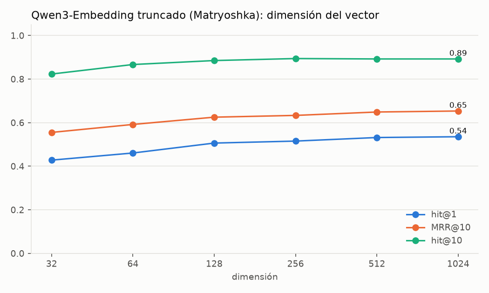

# Retrieval por texto (855 productos, ambientes IKEA)

Corridas: `20261023-173217_ablacion-retrieval`.

| método                                               | corrida                            | embedder   | texto            | filtro   | base   | consulta   | rerank          |   consultas |   hit@1 | hit@1_ic95     |   hit@3 |   hit@10 |   mrr@10 | mrr@10_ic95    |   recall_item@10 |   context_precision@10 |   ndcg@10 |   context_recall@3 |   context_recall@10 |   azar_hit@1 |
|:-----------------------------------------------------|:-----------------------------------|:-----------|:-----------------|:---------|:-------|:-----------|:----------------|------------:|--------:|:---------------|--------:|---------:|---------:|:---------------|-----------------:|-----------------------:|----------:|-------------------:|--------------------:|-------------:|
| hashing|description|filtro-kind                      | 20261023-173217_ablacion-retrieval | hashing    | description      | kind     | chroma | full       |                 |         552 |  0.5127 | [0.464, 0.563] |  0.7101 |   0.8841 |   0.6286 | [0.588, 0.672] |           0.8916 |                 0.6152 |    0.6281 |             0.7421 |              0.9076 |       0.0523 |
| hashing|description|filtro-type                      | 20261023-173217_ablacion-retrieval | hashing    | description      | type     | chroma | full       |                 |         552 |  0.5091 | [0.462, 0.559] |  0.7228 |   0.8913 |   0.6332 | [0.595, 0.673] |           0.8878 |                 0.6168 |    0.6365 |             0.7515 |              0.9068 |       0.016  |
| hashing|description|filtro-none                      | 20261023-173217_ablacion-retrieval | hashing    | description      | none     | chroma | full       |                 |         552 |  0.4928 | [0.442, 0.544] |  0.7065 |   0.8696 |   0.6161 | [0.577, 0.657] |           0.8764 |                 0.6022 |    0.6149 |             0.7452 |              0.9085 |       0.0017 |
| hashing|seller|filtro-kind                           | 20261023-173217_ablacion-retrieval | hashing    | seller           | kind     | chroma | full       |                 |         552 |  0.1775 | [0.145, 0.211] |  0.3804 |   0.712  |   0.3229 | [0.295, 0.353] |           0.7072 |                 0.316  |    0.3728 |             0.3781 |              0.7063 |       0.0523 |
| hashing|seller|filtro-type                           | 20261023-173217_ablacion-retrieval | hashing    | seller           | type     | chroma | full       |                 |         552 |  0.1322 | [0.106, 0.158] |  0.2826 |   0.558  |   0.2424 | [0.216, 0.270] |           0.5513 |                 0.2374 |    0.2827 |             0.2902 |              0.5667 |       0.016  |
| hashing|seller|filtro-none                           | 20261023-173217_ablacion-retrieval | hashing    | seller           | none     | chroma | full       |                 |         552 |  0.0761 | [0.057, 0.096] |  0.1703 |   0.317  |   0.1425 | [0.120, 0.167] |           0.3175 |                 0.1419 |    0.1608 |             0.2041 |              0.3859 |       0.0017 |
| bge|description|filtro-kind                          | 20261023-173217_ablacion-retrieval | bge        | description      | kind     | chroma | full       |                 |         552 |  0.4728 | [0.425, 0.520] |  0.6703 |   0.846  |   0.5889 | [0.548, 0.629] |           0.8612 |                 0.5742 |    0.5882 |             0.7092 |              0.8858 |       0.0523 |
| bge|description|filtro-type                          | 20261023-173217_ablacion-retrieval | bge        | description      | type     | chroma | full       |                 |         552 |  0.4764 | [0.431, 0.522] |  0.6848 |   0.8714 |   0.5994 | [0.562, 0.636] |           0.884  |                 0.5824 |    0.6056 |             0.7278 |              0.9068 |       0.016  |
| bge|description|filtro-none                          | 20261023-173217_ablacion-retrieval | bge        | description      | none     | chroma | full       |                 |         552 |  0.4764 | [0.431, 0.522] |  0.6775 |   0.8659 |   0.5972 | [0.560, 0.634] |           0.8802 |                 0.5819 |    0.6017 |             0.727  |              0.9127 |       0.0017 |
| bge|seller|filtro-kind                               | 20261023-173217_ablacion-retrieval | bge        | seller           | kind     | chroma | full       |                 |         552 |  0.1866 | [0.151, 0.225] |  0.3967 |   0.6793 |   0.3241 | [0.286, 0.367] |           0.6616 |                 0.3198 |    0.3675 |             0.4179 |              0.6963 |       0.0523 |
| bge|seller|filtro-type                               | 20261023-173217_ablacion-retrieval | bge        | seller           | type     | chroma | full       |                 |         552 |  0.1558 | [0.126, 0.189] |  0.3442 |   0.5598 |   0.2736 | [0.239, 0.312] |           0.5399 |                 0.269  |    0.3118 |             0.3608 |              0.5767 |       0.016  |
| bge|seller|filtro-none                               | 20261023-173217_ablacion-retrieval | bge        | seller           | none     | chroma | full       |                 |         552 |  0.1322 | [0.107, 0.162] |  0.3025 |   0.5145 |   0.241  | [0.209, 0.275] |           0.5133 |                 0.2366 |    0.2818 |             0.3412 |              0.5687 |       0.0017 |
| qwen3|description|filtro-kind                        | 20261023-173217_ablacion-retrieval | qwen3      | description      | kind     | chroma | full       |                 |         552 |  0.5254 | [0.480, 0.568] |  0.7083 |   0.8641 |   0.637  | [0.599, 0.676] |           0.8859 |                 0.6207 |    0.627  |             0.7573 |              0.8997 |       0.0523 |
| qwen3|description|filtro-type                        | 20261023-173217_ablacion-retrieval | qwen3      | description      | type     | chroma | full       |                 |         552 |  0.5326 | [0.490, 0.574] |  0.7283 |   0.8949 |   0.6515 | [0.617, 0.688] |           0.9144 |                 0.6297 |    0.6515 |             0.7821 |              0.9277 |       0.016  |
| qwen3|description|filtro-none                        | 20261023-173217_ablacion-retrieval | qwen3      | description      | none     | chroma | full       |                 |         552 |  0.5326 | [0.490, 0.574] |  0.7264 |   0.8877 |   0.65   | [0.615, 0.686] |           0.9087 |                 0.6302 |    0.6469 |             0.7865 |              0.9294 |       0.0017 |
| qwen3|seller|filtro-kind                             | 20261023-173217_ablacion-retrieval | qwen3      | seller           | kind     | chroma | full       |                 |         552 |  0.1504 | [0.126, 0.179] |  0.3188 |   0.6504 |   0.277  | [0.248, 0.311] |           0.6388 |                 0.2711 |    0.3306 |             0.3405 |              0.6694 |       0.0523 |
| qwen3|seller|filtro-type                             | 20261023-173217_ablacion-retrieval | qwen3      | seller           | type     | chroma | full       |                 |         552 |  0.1232 | [0.100, 0.150] |  0.2554 |   0.538  |   0.2274 | [0.199, 0.258] |           0.5152 |                 0.2254 |    0.2711 |             0.2767 |              0.5573 |       0.016  |
| qwen3|seller|filtro-none                             | 20261023-173217_ablacion-retrieval | qwen3      | seller           | none     | chroma | full       |                 |         552 |  0.1178 | [0.094, 0.142] |  0.2319 |   0.4565 |   0.2028 | [0.175, 0.231] |           0.4544 |                 0.2011 |    0.2377 |             0.257  |              0.504  |       0.0017 |
| bge|name+description|filtro-kind                     | 20261023-173217_ablacion-retrieval | bge        | name+description | kind     | chroma | full       |                 |         552 |  0.3931 | [0.355, 0.437] |  0.5978 |   0.8188 |   0.5188 | [0.484, 0.556] |           0.8289 |                 0.5121 |    0.5356 |             0.6631 |              0.8541 |       0.0523 |
| qwen3|name+description|filtro-kind                   | 20261023-173217_ablacion-retrieval | qwen3      | name+description | kind     | chroma | full       |                 |         552 |  0.4185 | [0.373, 0.467] |  0.6757 |   0.8424 |   0.5593 | [0.522, 0.597] |           0.8574 |                 0.5433 |    0.5656 |             0.7277 |              0.8787 |       0.0523 |
| qwen3|description|filtro-type|exact                  | 20261023-173217_ablacion-retrieval | qwen3      | description      | type     | exact  | full       |                 |         552 |  0.5326 | [0.490, 0.574] |  0.7283 |   0.8949 |   0.6515 | [0.617, 0.688] |           0.9144 |                 0.6297 |    0.6515 |             0.7821 |              0.9277 |       0.016  |
| qwen3|description|filtro-kind|exact                  | 20261023-173217_ablacion-retrieval | qwen3      | description      | kind     | exact  | full       |                 |         552 |  0.5254 | [0.480, 0.568] |  0.7083 |   0.8641 |   0.637  | [0.599, 0.676] |           0.8859 |                 0.6207 |    0.627  |             0.7573 |              0.8997 |       0.0523 |
| qwen3|description|filtro-type|consulta-type          | 20261023-173217_ablacion-retrieval | qwen3      | description      | type     | chroma | type       |                 |         552 |  0.2917 | [0.249, 0.335] |  0.5344 |   0.8098 |   0.4435 | [0.404, 0.483] |           0.8251 |                 0.428  |    0.4738 |             0.5756 |              0.8401 |       0.016  |
| qwen3|description|filtro-type|consulta-kind          | 20261023-173217_ablacion-retrieval | qwen3      | description      | type     | chroma | kind       |                 |         552 |  0.0634 | [0.039, 0.091] |  0.1739 |   0.404  |   0.1403 | [0.115, 0.172] |           0.3308 |                 0.1364 |    0.1682 |             0.1418 |              0.3409 |       0.016  |
| qwen3|description|filtro-type|dim-32                 | 20261023-173217_ablacion-retrieval | qwen3      | description      | type     | chroma | full       |                 |         552 |  0.4275 | [0.386, 0.473] |  0.6431 |   0.8243 |   0.5551 | [0.521, 0.593] |           0.8498 |                 0.5416 |    0.5619 |             0.6995 |              0.8781 |       0.016  |
| qwen3|description|filtro-type|dim-64                 | 20261023-173217_ablacion-retrieval | qwen3      | description      | type     | chroma | full       |                 |         552 |  0.4638 | [0.422, 0.508] |  0.6866 |   0.8678 |   0.5934 | [0.559, 0.630] |           0.8802 |                 0.5767 |    0.6012 |             0.7307 |              0.9036 |       0.016  |
| qwen3|description|filtro-type|dim-128                | 20261023-173217_ablacion-retrieval | qwen3      | description      | type     | chroma | full       |                 |         552 |  0.5072 | [0.464, 0.549] |  0.712  |   0.8822 |   0.6249 | [0.590, 0.660] |           0.8973 |                 0.6056 |    0.6283 |             0.7645 |              0.9172 |       0.016  |
| qwen3|description|filtro-type|dim-256                | 20261023-173217_ablacion-retrieval | qwen3      | description      | type     | chroma | full       |                 |         552 |  0.5163 | [0.474, 0.558] |  0.7029 |   0.8949 |   0.6336 | [0.599, 0.668] |           0.9144 |                 0.6169 |    0.6382 |             0.7512 |              0.9237 |       0.016  |
| qwen3|description|filtro-type|dim-512                | 20261023-173217_ablacion-retrieval | qwen3      | description      | type     | chroma | full       |                 |         552 |  0.5326 | [0.487, 0.577] |  0.7264 |   0.8931 |   0.6481 | [0.612, 0.684] |           0.9125 |                 0.6274 |    0.6477 |             0.7631 |              0.9244 |       0.016  |
| qwen3|description|filtro-type|chunks-lines-max       | 20261023-173217_ablacion-retrieval | qwen3      | description      | type     | chroma | full       |                 |         552 |  0.2681 | [0.234, 0.303] |  0.5199 |   0.7971 |   0.4286 | [0.402, 0.458] |           0.789  |                 0.4237 |    0.468  |             0.5522 |              0.8068 |       0.016  |
| qwen3|description|filtro-type|chunks-lines-aligned   | 20261023-173217_ablacion-retrieval | qwen3      | description      | type     | chroma | full       |                 |         552 |  0.5109 | [0.465, 0.562] |  0.7264 |   0.8895 |   0.6335 | [0.595, 0.673] |           0.9087 |                 0.6158 |    0.6386 |             0.7675 |              0.9237 |       0.016  |
| qwen3|description|filtro-type|rerank-minilm-reranker | 20261023-173217_ablacion-retrieval | qwen3      | description      | type     | chroma | full       | minilm-reranker |         552 |  0.4167 | [0.367, 0.463] |  0.6467 |   0.8949 |   0.5633 | [0.521, 0.604] |           0.9144 |                 0.5435 |    0.5886 |             0.6862 |              0.9277 |       0.016  |

## hit@1 por categoría

| método | armchair (18) | bench (4) | cabinet (41) | chair (45) | deco (208) | dresser (1) | lamp (64) | ottoman (6) | rug (45) | shelf (21) | sofa (24) | stool (8) | table (67) |
|---|---|---|---|---|---|---|---|---|---|---|---|---|---|
| hashing|description|filtro-kind | 0.67 | 1.00 | 0.71 | 0.67 | 0.34 | 1.00 | 0.67 | 0.83 | 0.36 | 0.48 | 0.38 | 1.00 | 0.69 |
| hashing|description|filtro-type | 0.67 | 1.00 | 0.78 | 0.67 | 0.33 | 1.00 | 0.58 | 0.83 | 0.36 | 0.48 | 0.38 | 1.00 | 0.73 |
| hashing|description|filtro-none | 0.67 | 0.75 | 0.76 | 0.67 | 0.32 | 0.00 | 0.56 | 0.67 | 0.36 | 0.43 | 0.33 | 0.88 | 0.73 |
| hashing|seller|filtro-kind | 0.17 | 0.25 | 0.24 | 0.22 | 0.15 | 0.00 | 0.11 | 0.33 | 0.07 | 0.19 | 0.25 | 0.38 | 0.27 |
| hashing|seller|filtro-type | 0.11 | 0.25 | 0.20 | 0.22 | 0.11 | 0.00 | 0.06 | 0.33 | 0.07 | 0.14 | 0.21 | 0.12 | 0.16 |
| hashing|seller|filtro-none | 0.06 | 0.00 | 0.07 | 0.20 | 0.06 | 0.00 | 0.05 | 0.00 | 0.07 | 0.05 | 0.08 | 0.12 | 0.10 |
| bge|description|filtro-kind | 0.56 | 1.00 | 0.56 | 0.62 | 0.34 | 1.00 | 0.61 | 0.67 | 0.18 | 0.43 | 0.54 | 1.00 | 0.64 |
| bge|description|filtro-type | 0.50 | 1.00 | 0.59 | 0.62 | 0.34 | 1.00 | 0.61 | 0.67 | 0.18 | 0.43 | 0.54 | 1.00 | 0.67 |
| bge|description|filtro-none | 0.50 | 1.00 | 0.59 | 0.62 | 0.34 | 1.00 | 0.61 | 0.67 | 0.18 | 0.43 | 0.54 | 1.00 | 0.67 |
| bge|seller|filtro-kind | 0.17 | 0.75 | 0.17 | 0.33 | 0.14 | 0.00 | 0.12 | 0.00 | 0.07 | 0.10 | 0.25 | 0.62 | 0.31 |
| bge|seller|filtro-type | 0.11 | 0.75 | 0.17 | 0.29 | 0.13 | 0.00 | 0.08 | 0.00 | 0.07 | 0.10 | 0.21 | 0.38 | 0.22 |
| bge|seller|filtro-none | 0.11 | 0.25 | 0.15 | 0.29 | 0.10 | 0.00 | 0.08 | 0.00 | 0.07 | 0.10 | 0.21 | 0.38 | 0.19 |
| qwen3|description|filtro-kind | 0.72 | 1.00 | 0.68 | 0.84 | 0.36 | 1.00 | 0.61 | 1.00 | 0.31 | 0.43 | 0.58 | 0.88 | 0.64 |
| qwen3|description|filtro-type | 0.72 | 1.00 | 0.73 | 0.84 | 0.35 | 1.00 | 0.59 | 1.00 | 0.31 | 0.43 | 0.62 | 0.88 | 0.69 |
| qwen3|description|filtro-none | 0.72 | 1.00 | 0.73 | 0.84 | 0.35 | 1.00 | 0.59 | 1.00 | 0.31 | 0.43 | 0.62 | 0.88 | 0.69 |
| qwen3|seller|filtro-kind | 0.11 | 0.75 | 0.10 | 0.44 | 0.08 | 1.00 | 0.14 | 0.00 | 0.04 | 0.24 | 0.17 | 0.25 | 0.21 |
| qwen3|seller|filtro-type | 0.11 | 0.75 | 0.12 | 0.38 | 0.08 | 1.00 | 0.06 | 0.00 | 0.04 | 0.19 | 0.12 | 0.12 | 0.13 |
| qwen3|seller|filtro-none | 0.11 | 0.75 | 0.12 | 0.38 | 0.08 | 1.00 | 0.06 | 0.00 | 0.04 | 0.14 | 0.12 | 0.00 | 0.13 |
| bge|name+description|filtro-kind | 0.39 | 1.00 | 0.41 | 0.58 | 0.26 | 1.00 | 0.42 | 0.83 | 0.22 | 0.24 | 0.46 | 0.88 | 0.63 |
| qwen3|name+description|filtro-kind | 0.72 | 0.50 | 0.39 | 0.64 | 0.32 | 1.00 | 0.44 | 0.67 | 0.22 | 0.33 | 0.46 | 0.88 | 0.55 |
| qwen3|description|filtro-type|exact | 0.72 | 1.00 | 0.73 | 0.84 | 0.35 | 1.00 | 0.59 | 1.00 | 0.31 | 0.43 | 0.62 | 0.88 | 0.69 |
| qwen3|description|filtro-kind|exact | 0.72 | 1.00 | 0.68 | 0.84 | 0.36 | 1.00 | 0.61 | 1.00 | 0.31 | 0.43 | 0.58 | 0.88 | 0.64 |
| qwen3|description|filtro-type|consulta-type | 0.22 | 0.50 | 0.24 | 0.69 | 0.23 | 0.00 | 0.27 | 0.50 | 0.13 | 0.29 | 0.17 | 0.75 | 0.36 |
| qwen3|description|filtro-type|consulta-kind | 0.06 | 0.00 | 0.05 | 0.07 | 0.11 | 0.00 | 0.00 | 0.00 | 0.00 | 0.00 | 0.00 | 0.25 | 0.06 |
| qwen3|description|filtro-type|dim-32 | 0.44 | 1.00 | 0.56 | 0.78 | 0.29 | 1.00 | 0.41 | 0.50 | 0.20 | 0.29 | 0.50 | 1.00 | 0.60 |
| qwen3|description|filtro-type|dim-64 | 0.67 | 0.75 | 0.73 | 0.76 | 0.29 | 1.00 | 0.45 | 0.83 | 0.29 | 0.38 | 0.46 | 1.00 | 0.61 |
| qwen3|description|filtro-type|dim-128 | 0.72 | 1.00 | 0.73 | 0.76 | 0.33 | 1.00 | 0.55 | 0.83 | 0.29 | 0.43 | 0.58 | 1.00 | 0.69 |
| qwen3|description|filtro-type|dim-256 | 0.72 | 1.00 | 0.73 | 0.80 | 0.35 | 1.00 | 0.59 | 0.83 | 0.27 | 0.43 | 0.58 | 0.88 | 0.66 |
| qwen3|description|filtro-type|dim-512 | 0.72 | 1.00 | 0.76 | 0.84 | 0.35 | 1.00 | 0.58 | 1.00 | 0.31 | 0.43 | 0.58 | 0.88 | 0.70 |
| qwen3|description|filtro-type|chunks-lines-max | 0.33 | 0.75 | 0.20 | 0.36 | 0.18 | 1.00 | 0.41 | 0.83 | 0.11 | 0.29 | 0.17 | 0.75 | 0.36 |
| qwen3|description|filtro-type|chunks-lines-aligned | 0.78 | 1.00 | 0.71 | 0.82 | 0.35 | 1.00 | 0.38 | 0.67 | 0.33 | 0.48 | 0.62 | 1.00 | 0.73 |
| qwen3|description|filtro-type|rerank-minilm-reranker | 0.50 | 0.75 | 0.56 | 0.62 | 0.33 | 1.00 | 0.48 | 0.50 | 0.16 | 0.33 | 0.29 | 0.62 | 0.57 |

## Por pasada de consultas (v1: muebles del primer alcance; v2: la ampliación)

| método | consultas_ambiente_v1 hit@1 / MRR | consultas_ambiente_v2 hit@1 / MRR |
|---|---|---|
| hashing|description|filtro-kind | 0.568 / 0.687 (199) | 0.482 / 0.596 (353) |
| hashing|description|filtro-type | 0.583 / 0.715 (199) | 0.467 / 0.587 (353) |
| hashing|description|filtro-none | 0.578 / 0.703 (199) | 0.445 / 0.567 (353) |
| hashing|seller|filtro-kind | 0.201 / 0.323 (199) | 0.164 / 0.323 (353) |
| hashing|seller|filtro-type | 0.156 / 0.250 (199) | 0.119 / 0.238 (353) |
| hashing|seller|filtro-none | 0.111 / 0.162 (199) | 0.057 / 0.131 (353) |
| bge|description|filtro-kind | 0.513 / 0.632 (199) | 0.450 / 0.564 (353) |
| bge|description|filtro-type | 0.518 / 0.647 (199) | 0.453 / 0.573 (353) |
| bge|description|filtro-none | 0.518 / 0.643 (199) | 0.453 / 0.571 (353) |
| bge|seller|filtro-kind | 0.241 / 0.358 (199) | 0.156 / 0.305 (353) |
| bge|seller|filtro-type | 0.191 / 0.295 (199) | 0.136 / 0.262 (353) |
| bge|seller|filtro-none | 0.181 / 0.282 (199) | 0.105 / 0.218 (353) |
| qwen3|description|filtro-kind | 0.613 / 0.708 (199) | 0.476 / 0.597 (353) |
| qwen3|description|filtro-type | 0.633 / 0.736 (199) | 0.476 / 0.604 (353) |
| qwen3|description|filtro-none | 0.633 / 0.733 (199) | 0.476 / 0.603 (353) |
| qwen3|seller|filtro-kind | 0.211 / 0.339 (199) | 0.116 / 0.242 (353) |
| qwen3|seller|filtro-type | 0.166 / 0.278 (199) | 0.099 / 0.199 (353) |
| qwen3|seller|filtro-none | 0.166 / 0.269 (199) | 0.091 / 0.166 (353) |
| bge|name+description|filtro-kind | 0.482 / 0.598 (199) | 0.343 / 0.474 (353) |
| qwen3|name+description|filtro-kind | 0.502 / 0.623 (199) | 0.371 / 0.523 (353) |
| qwen3|description|filtro-type|exact | 0.633 / 0.736 (199) | 0.476 / 0.604 (353) |
| qwen3|description|filtro-kind|exact | 0.613 / 0.708 (199) | 0.476 / 0.597 (353) |
| qwen3|description|filtro-type|consulta-type | 0.347 / 0.503 (199) | 0.261 / 0.410 (353) |
| qwen3|description|filtro-type|consulta-kind | 0.040 / 0.081 (199) | 0.076 / 0.174 (353) |
| qwen3|description|filtro-type|dim-32 | 0.523 / 0.642 (199) | 0.374 / 0.506 (353) |
| qwen3|description|filtro-type|dim-64 | 0.558 / 0.675 (199) | 0.411 / 0.547 (353) |
| qwen3|description|filtro-type|dim-128 | 0.603 / 0.710 (199) | 0.453 / 0.577 (353) |
| qwen3|description|filtro-type|dim-256 | 0.598 / 0.712 (199) | 0.470 / 0.589 (353) |
| qwen3|description|filtro-type|dim-512 | 0.633 / 0.733 (199) | 0.476 / 0.601 (353) |
| qwen3|description|filtro-type|chunks-lines-max | 0.276 / 0.454 (199) | 0.264 / 0.414 (353) |
| qwen3|description|filtro-type|chunks-lines-aligned | 0.653 / 0.747 (199) | 0.431 / 0.570 (353) |
| qwen3|description|filtro-type|rerank-minilm-reranker | 0.447 / 0.591 (199) | 0.399 / 0.548 (353) |

## Base vectorial, query rewriting y reranking

## ¿Cuántos candidatos? La curva de hit@k

| método | k=1 | k=2 | k=3 | k=5 | k=10 | k=15 | k=20 | k=30 | k=50 |
|---|---|---|---|---|---|---|---|---|---|
| Qwen3, filtro por tipo | 0.533 | 0.672 | 0.728 | 0.813 | 0.895 | 0.933 | 0.958 | 0.982 | 0.995 |
| BGE, filtro por tipo | 0.476 | 0.605 | 0.685 | 0.759 | 0.871 | 0.909 | 0.951 | 0.980 | 0.995 |
| hashing, filtro por tipo | 0.509 | 0.645 | 0.723 | 0.808 | 0.891 | 0.920 | 0.933 | 0.966 | 0.989 |

## Dimensión del embedding (Matryoshka)

| dimensión | bytes por vector | hit@1 | hit@10 | MRR@10 |
|---|---|---|---|---|
| 32 | 128 | 0.427 | 0.824 | 0.555 |
| 64 | 256 | 0.464 | 0.868 | 0.593 |
| 128 | 512 | 0.507 | 0.882 | 0.625 |
| 256 | 1024 | 0.516 | 0.895 | 0.634 |
| 512 | 2048 | 0.533 | 0.893 | 0.648 |
| 1024 | 4096 | 0.533 | 0.895 | 0.651 |

## Splitting: ¿un documento por producto o un chunk por línea?

| splitting | hit@1 | hit@10 | MRR@10 |
|---|---|---|---|
| un documento por producto (ChromaDB) | 0.533 [0.49–0.57] | 0.895 | 0.651 |
| cada línea un chunk, el producto vale su mejor línea | 0.268 [0.23–0.30] | 0.797 | 0.429 |
| línea contra línea del mismo rótulo, promedio | 0.511 [0.46–0.56] | 0.889 | 0.633 |

## Reproducibilidad: tres escrituras independientes de las consultas

La búsqueda es determinística: lo que varía es quién escribe la consulta (en el flujo, el paso plan). Las mismas fotos y los mismos prompts, tres subagentes distintos por lote. Promedio ± desvío estándar (n=3) y el rango.

| método | consultas (r1/r2/r3) | hit@1 | MRR@10 | hit@10 |
|---|---|---|---|---|
| bge|description|filtro-type | 552/550/550 | 0.488 ± 0.015 (0.476–0.505) | 0.609 ± 0.009 (0.599–0.618) | 0.873 ± 0.002 (0.871–0.875) |
| hashing|description|filtro-none | 552/550/550 | 0.496 ± 0.025 (0.473–0.522) | 0.618 ± 0.019 (0.600–0.637) | 0.866 ± 0.016 (0.849–0.880) |
| hashing|description|filtro-type | 552/550/550 | 0.513 ± 0.027 (0.487–0.542) | 0.635 ± 0.021 (0.615–0.656) | 0.886 ± 0.010 (0.875–0.891) |
| hashing|seller|filtro-none | 552/550/550 | 0.074 ± 0.002 (0.073–0.076) | 0.139 ± 0.003 (0.136–0.142) | 0.319 ± 0.008 (0.313–0.327) |
| qwen3|description|filtro-kind | 552/550/550 | 0.536 ± 0.024 (0.518–0.564) | 0.640 ± 0.015 (0.627–0.657) | 0.867 ± 0.003 (0.864–0.871) |
| qwen3|description|filtro-type | 552/550/550 | 0.544 ± 0.026 (0.525–0.575) | 0.655 ± 0.017 (0.640–0.674) | 0.899 ± 0.004 (0.895–0.904) |

## La imagen generada

Fidelidad: cada producto de la lista buscado en la imagen final (Grounding DINO), recortado y comparado con su foto del catálogo (DINOv3); *identificado* = el más parecido al recorte entre los productos de su tipo es él. Ambiente: SSIM fuera de los muebles y fracción de puntos SIFT de la foto original reencontrados (RANSAC). Pedido: SigLIP 2 entre el pedido y la imagen final, menos lo mismo con la foto vacía; puesto del pedido real entre él y seis pedidos de contraste.

| corrida | generador | detectados | identificados@1 | coseno | inventadas | SSIM fuera | SIFT | pedido Δ (puesto) |
|---|---|---|---|---|---|---|---|---|
| experimento | nano_banana_2 | 6/6 | 0.6667 | 0.5342 | 1 | 0.8291 | 0.1329 | +0.061 (1/7) |
| prueba-alvear2 | nano_banana_2 | 4/4 | 0.75 | 0.6824 | 0 | 0.9747 | 0.5521 | +0.077 (1/7) |

### `experimento` por producto

| producto | kind | puesto | coseno |
|---|---|---|---|
| 703.233.51 | bookcase | 1/63 | 0.7967 |
| 391.505.88 | armchair | 1/78 | 0.8509 |
| 402.712.59 | rug | 9/89 | 0.1819 |
| 302.865.67 | floor lamp | 1/102 | 0.2782 |
| 102.397.13 | side table | 1/71 | 0.6031 |
| 802.841.94 | curtains | 10/255 | 0.4941 |

### `prueba-alvear2` por producto

| producto | kind | puesto | coseno |
|---|---|---|---|
| 691.249.46 | sofa | 7/37 | 0.6662 |
| 391.505.88 | armchair | 1/78 | 0.8996 |
| 002.852.58 | rug | 1/89 | 0.2853 |
| 302.397.12 | coffee table | 1/71 | 0.8785 |

### La vara: la misma identificación con fotos reales (ambientes IKEA)

545 recortes de 64 ambientes: hit@1 0.444 [0.39–0.50], MRR@10 0.556, coseno medio 0.411.

| grupo | hit@1 | recortes |
|---|---|---|
| armchair | 0.80 | 5 |
| bench | 1.00 | 2 |
| cabinet | 0.62 | 47 |
| chair | 0.75 | 122 |
| curtains | 0.11 | 27 |
| cushion | 0.24 | 95 |
| desk | 0.00 | 1 |
| floor lamp | 0.44 | 18 |
| mirror | 0.33 | 3 |
| ottoman | 0.67 | 3 |
| pendant lamp | 0.44 | 18 |
| plant | 0.10 | 20 |
| rug | 0.30 | 54 |
| shelf | 0.14 | 21 |
| sofa | 0.48 | 29 |
| stool | 0.73 | 11 |
| table | 0.75 | 16 |
| vase | 0.50 | 10 |
| wall art | 0.26 | 43 |

## Relevancia graduada del top-3 (juez)

Método `qwen3|description|filtro-type`. Un juez (subagente) califica cada uno de los tres primeros candidatos contra la pieza que se ve en el ambiente: 2 el mismo o indistinguible, 1 una alternativa aceptable, 0 no sirve. *útil@k*: alguno de los k primeros con 1 o 2.

| consultas | n | nota del 1.º | útil@1 | útil@3 | un 2 en el top-3 | NDCG@3 |
|---|---|---|---|---|---|---|
| todas | 150 | 1.07 | 0.747 [0.68–0.82] | 0.840 [0.78–0.89] | 0.427 | 0.783 |
| con anotado | 75 | 1.41 | 0.867 [0.78–0.94] | 0.947 [0.89–0.99] | 0.693 | 0.884 |
| sin anotado | 75 | 0.73 | 0.627 [0.51–0.73] | 0.733 [0.63–0.83] | 0.160 | 0.682 |

Acuerdo con el ground truth: de 59 productos anotados que aparecen en el top-3, el juez le dio 2 al 81%; a los demás candidatos, al 5%.

## La respuesta en texto: faithfulness y answer relevance (RAGAS)

Faithfulness: de las afirmaciones de hecho del porqué de cada producto, cuántas se infieren de lo que vio el sistema (pedido, foto del ambiente, foto, descripción y medida de cada producto). Answer relevance: coseno medio (Qwen3) entre el pedido original y tres pedidos que un juez que no lo vio infiere de la respuesta; la vara es el mismo coseno con pedidos de contraste. Jueces: subagentes de Claude Code.

| corrida | afirmaciones | faithfulness | answer relevance | vara | no sostenidas |
|---|---|---|---|---|---|
| experimento | 34 | 0.9706 | 0.6038 | 0.3951 | It is the only round rug available |
| prueba-alvear | 27 | 0.8889 | 0.6901 | 0.3743 | The floor is oak; The rug is the largest option; The rug reaches under the sofa's front legs, the table and the armchair |
| prueba-alvear2 | 25 | 0.96 | 0.7261 | 0.3743 | The rug is large enough to sit under the front of both the sofa and the armchair |
| prueba-alvear2-scene-v2 | 26 | 0.9231 | 0.7158 | 0.3743 | The rug is large enough to go under the front of both the sofa and the armchair; The table's size suits a three-seat sofa |

## El espacio de embeddings

855 descripciones. Separabilidad: de cada producto, ¿su vecino más cercano es de su mismo kind / tipo?, y el silhouette por kind (coseno).

| embedder | vecino del mismo kind | vecino del mismo tipo | silhouette por kind |
|---|---|---|---|
| hashing | 0.834 | 0.910 | 0.076 |
| bge | 0.918 | 0.964 | 0.222 |
| qwen3 | 0.894 | 0.961 | 0.179 |

| consulta | mejor coseno | coseno del 10.º | kinds del top-10 |
|---|---|---|---|
| del dominio | 0.833 | 0.751 | armchair, armchair, armchair, ottoman, armchair, sofa, sofa, armchair, armchair, armchair |
| fuera del dominio | 0.318 | 0.283 | floor lamp, desk, desk lamp, rug, rug, desk lamp, armchair, low stool, desk lamp, sofa |

## Texto vs. imagen

| | consultas | hit@1 | hit@10 | MRR@10 |
|---|---|---|---|---|
| v0 imagen (20261006-231131_retriever_abl-retriever-name-dinov3__method-none__category_filter-true) | 325 recortes | 0.508 | 0.819 | 0.603 |
| v1 texto (qwen3|description|filtro-type) | 207 consultas | 0.618 | 0.908 | 0.717 |

## Corridas anteriores (otro catálogo u otras consultas)

No se mezclan con las de arriba: cambian el universo de búsqueda o las consultas.

### `20261021-133226_ablacion-texto` (275 productos)

| método                             |   consultas |   hit@1 |   hit@10 |   mrr@10 |
|:-----------------------------------|------------:|--------:|---------:|---------:|
| hashing|description|filtro-kind    |         207 |  0.5459 |   0.8937 |   0.6698 |
| hashing|description|filtro-type    |         207 |  0.5604 |   0.9324 |   0.6963 |
| hashing|description|filtro-none    |         207 |  0.5604 |   0.9275 |   0.6924 |
| hashing|seller|filtro-kind         |         207 |  0.1932 |   0.6957 |   0.3144 |
| hashing|seller|filtro-type         |         207 |  0.1546 |   0.5604 |   0.2469 |
| hashing|seller|filtro-none         |         207 |  0.1449 |   0.4396 |   0.2083 |
| bge|description|filtro-kind        |         207 |  0.4976 |   0.8937 |   0.6197 |
| bge|description|filtro-type        |         207 |  0.5024 |   0.9179 |   0.6337 |
| bge|description|filtro-none        |         207 |  0.5024 |   0.9179 |   0.6315 |
| bge|seller|filtro-kind             |         207 |  0.2367 |   0.6473 |   0.3476 |
| bge|seller|filtro-type             |         207 |  0.1884 |   0.5749 |   0.2946 |
| bge|seller|filtro-none             |         207 |  0.1884 |   0.5556 |   0.2905 |
| qwen3|description|filtro-kind      |         207 |  0.599  |   0.8744 |   0.6903 |
| qwen3|description|filtro-type      |         207 |  0.6184 |   0.9082 |   0.7172 |
| qwen3|description|filtro-none      |         207 |  0.6184 |   0.8986 |   0.7152 |
| qwen3|seller|filtro-kind           |         207 |  0.2077 |   0.657  |   0.3277 |
| qwen3|seller|filtro-type           |         207 |  0.1643 |   0.5894 |   0.2686 |
| qwen3|seller|filtro-none           |         207 |  0.1643 |   0.5749 |   0.2655 |
| bge|name+description|filtro-kind   |         207 |  0.4589 |   0.8502 |   0.5814 |
| qwen3|name+description|filtro-kind |         207 |  0.4831 |   0.8406 |   0.6031 |

### `20261021-141030_ablacion-texto-268` (268 productos)

| método                             |   consultas |   hit@1 |   hit@10 |   mrr@10 |
|:-----------------------------------|------------:|--------:|---------:|---------:|
| hashing|description|filtro-kind    |         198 |  0.5707 |   0.8939 |   0.6882 |
| hashing|description|filtro-type    |         198 |  0.5859 |   0.9343 |   0.716  |
| hashing|description|filtro-none    |         198 |  0.5859 |   0.9293 |   0.7118 |
| hashing|seller|filtro-kind         |         198 |  0.202  |   0.6869 |   0.324  |
| hashing|seller|filtro-type         |         198 |  0.1566 |   0.5505 |   0.2532 |
| hashing|seller|filtro-none         |         198 |  0.1465 |   0.4343 |   0.213  |
| bge|description|filtro-kind        |         198 |  0.5152 |   0.8939 |   0.634  |
| bge|description|filtro-type        |         198 |  0.5202 |   0.9192 |   0.6486 |
| bge|description|filtro-none        |         198 |  0.5202 |   0.9192 |   0.6463 |
| bge|seller|filtro-kind             |         198 |  0.2424 |   0.6667 |   0.3589 |
| bge|seller|filtro-type             |         198 |  0.1919 |   0.5909 |   0.3034 |
| bge|seller|filtro-none             |         198 |  0.1919 |   0.5707 |   0.2992 |
| qwen3|description|filtro-kind      |         198 |  0.6162 |   0.8788 |   0.7093 |
| qwen3|description|filtro-type      |         198 |  0.6364 |   0.9141 |   0.7374 |
| qwen3|description|filtro-none      |         198 |  0.6364 |   0.904  |   0.7353 |
| qwen3|seller|filtro-kind           |         198 |  0.2121 |   0.6768 |   0.3398 |
| qwen3|seller|filtro-type           |         198 |  0.1667 |   0.6212 |   0.2805 |
| qwen3|seller|filtro-none           |         198 |  0.1667 |   0.6061 |   0.2772 |
| bge|name+description|filtro-kind   |         198 |  0.4848 |   0.8485 |   0.6001 |
| qwen3|name+description|filtro-kind |         198 |  0.5051 |   0.8384 |   0.6233 |

### `20261022-175001_ablacion-reranking` (268 productos)

| método                                    |   consultas |   hit@1 |   hit@10 |   mrr@10 |
|:------------------------------------------|------------:|--------:|---------:|---------:|
| qwen3|description|filtro-type             |         198 |  0.6364 |   0.9141 |   0.7374 |
| qwen3|description|filtro-type|rerank-opus |         198 |  0.803  |   0.9141 |   0.8474 |

