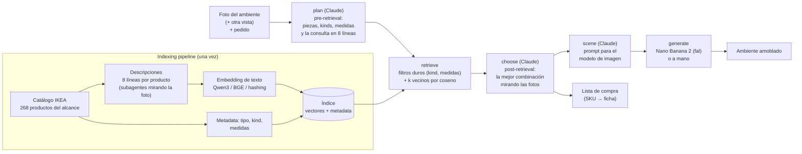

# Arquitectura (v1: RAG por texto)

Entrada: una foto del ambiente y el pedido del usuario en texto libre. Salida: los productos
del catálogo IKEA que hacen falta (la lista de compra) y el ambiente amoblado con ellos.

El núcleo es `roomrag` (en `desde_youseeyoubuy/roomrag/`), el mismo paquete que usa el proyecto
YouSeeYouBuy: el TP lo instala tal cual y le suma lo propio (el catálogo IKEA, los generadores
de imagen, la evaluación y las apps, en `src/amoblai/`). La v0, que recuperaba por imagen
(recortes de un ambiente generado + embeddings de imagen), está en `deprecated/`, con su
arquitectura en `deprecated/docs/ARQUITECTURA_v0.md`.

## Los pasos y el código

| Paso (terminología RAG) | Dónde | Qué hace |
|---|---|---|
| **Data loading** | `amoblai/data/` (`download`, `ikea`, `catalog`) | Descarga el dataset fijado a un commit, carga los pickles con un unpickler restringido y une todo por SKU. |
| **Preprocesamiento** | `amoblai/catalogo_ikea.py`, `configs/categories.yaml`, `catalogo/correcciones.yaml` | Elige los productos del alcance (sofá, sillón, silla, mesa, alfombra), los lleva al formato de roomrag (tipo, kind, medidas sin ambigüedad, fotos) y aplica las correcciones a mano: 7 escritorios que IKEA tipifica como mesas y 7 SKUs excluidos porque su foto es la de otra medida del mismo modelo. |
| **Splitting** | `catalogo/descripciones.jsonl` | La unidad que se indexa es la descripción de un producto: ocho líneas fijas (Type, Use, Style, Materials, Colors, Shape, Feel, Goes with), 60 a 90 palabras, escritas por subagentes de Claude Code mirando la foto con el prompt `describe_product_v2` de roomrag. Sin marca, precio ni medidas (el tamaño va por filtro). |
| **Embedding** | `roomrag/embed.py` | Modelos de texto locales de Hugging Face (Qwen3-Embedding-0.6B por defecto, BGE-base) o hashing de palabras; vectores normalizados (el producto interno es el coseno). |
| **Vector store** | `roomrag/index.py` | Índice en `data/cache/roomrag/`: un vector por producto, en el orden de `items.jsonl`, con la metadata (tipo, kind, medidas) para los filtros; descripciones y vectores en caché por contenido. Con 268 productos la búsqueda exacta alcanza; un ANN (HNSW) entra en el mismo lugar. |
| **Pre-retrieval: query rewriting** | `roomrag/steps.py: plan`, `prompts/search_query_v2.md` | Claude lee la foto y el pedido como un decorador: decide las piezas (1 a 4), el kind de cada una (filtro duro), el máximo que puede medir y escribe **el producto ideal en las mismas ocho líneas que el catálogo**. La consulta y los documentos quedan en el mismo formato y vocabulario (idea tipo HyDE). |
| **Retrieval con metadata filtering** | `roomrag/search.py`, `roomrag/filters.py` | Primero los filtros duros (kind, medidas con un 15% de holgura), después los k más cercanos por coseno (3 candidatos por pieza). Una pieza sin nada en el catálogo queda anotada y el flujo sigue. |
| **Post-retrieval: reranking/selección** | `roomrag/steps.py: choose`, `prompts/choose_combination_v1.md` | Claude ve la foto del ambiente y las fotos de todos los candidatos y elige uno por pieza: la mejor **combinación**, no el mejor de cada uno por separado. |
| **Generación** | `roomrag/steps.py: scene`, `amoblai/generacion.py` | Claude escribe el prompt del modelo de imagen (dónde va cada producto, hacia dónde mira, qué tamaño tiene al lado de lo que ya está). El modelo de imagen recibe la foto, las fotos de los productos elegidos y ese prompt: Nano Banana 2 por fal, gpt-image por OpenAI, o a mano en ChatGPT/Gemini. |

## Decisiones

**Por qué texto y no imagen (v0 → v1).** La v0 generaba primero un ambiente con muebles
genéricos, los detectaba y recortaba, y buscaba cada recorte por imagen. Además de caro (dos
generaciones por corrida) y frágil (detector, segmentación), el producto elegido dependía de lo
que se le ocurriera al primer generador. Con texto, el LLM decide qué hace falta y cómo tiene
que ser, y la búsqueda compara cosas comparables. Con el mismo ground truth (65 ambientes
IKEA), el retrieval por texto supera al mejor por imagen (ver docs/EXPERIMENTOS.md).

**Descripciones propias, no las del vendedor.** El texto de IKEA es una frase de marketing
("lightweight and easy to move"). Las ocho líneas describen lo que importa para elegir un
mueble para un ambiente, en un formato fijo para todo el catálogo. Es la diferencia más grande
de la ablación (hit@1 0,15 → 0,56 con el mismo embedder).

**El tipo y el tamaño van como filtros, no como palabras en el vector.** Un vector no sabe que
un sillón no es una silla, ni que un sofá de 2,40 m no entra en 2 m. Los `kinds`
(`roomrag/kinds.py`) son el filtro más fino: "silla de comedor" vs. "silla de escritorio" vs.
"sillón". Se asignaron mirando la foto de cada producto (no solo el `type` de IKEA).

**Las descripciones las escriben subagentes, sin API.** Cada subagente recibió un lote de ~35
productos, miró las fotos y escribió las descripciones con el mismo prompt que usaría un
describer por API, y las validó con `python -m amoblai.descripciones` (ocho líneas en orden,
largo, estilos de la lista fija, sin marca, nombre comercial ni medidas). El índice se puede
reconstruir con un describer por API (`anthropic_vision`) cambiando una línea de la config.

**Claude para plan, choose y scene.** Claude Opus 5.5 (effort `medium`) mira fotos y escribe
JSON. Cada llamada pasa por el tope de gasto de su cuenta y queda en `resultados/gastos.jsonl`
(una corrida completa ≈ US$0,12).

**Generación: Nano Banana 2 por fal.** En la prueba de YouSeeYouBuy, Gemini conservó la forma
de los muebles mejor que gpt-image; con `aspect_ratio: auto` dibuja en la proporción de la
foto. El generador `manual` deja una carpeta con las imágenes en orden y el prompt para hacerlo
a mano.

**Otra vista del ambiente, solo para el LLM.** Con `--vista`, otra foto del mismo ambiente desde
otro ángulo va a plan, choose y scene después de las imágenes de cada paso (la numeración de los
prompts no cambia), con una nota: sirve para entender el tamaño y la forma del cuarto, y todo se
ubica en la imagen 1. El modelo de imagen recibe solo la foto que se amobla: el prompt de scene
no menciona la otra.

**Caché y reanudación.** Cada paso escribe su archivo en la carpeta de la corrida
(`1_searches.json`, `2_candidates.json`, `3_choice.json`, `4_scene.json`, `5_image.json`,
`final.png`); si existe, no se repite. Nada se paga dos veces.

**LangChain no.** El flujo son cinco pasos fijos con imágenes de entrada; roomrag los
implementa con httpx, con reintentos, tope de gasto y tests sin red (`httpx.MockTransport`).
Un framework de orquestación no agrega nada acá.

## Lo que no hace la v1

- No ubica los muebles con precisión ni a escala: lo decide el modelo de imagen a partir del
  prompt (el 3D es de YouSeeYouBuy). Ver FUTURO.md.
- El modelo de imagen puede deformar un producto o retocar el ambiente: el prompt pide cada
  producto exactamente como en su foto y el resto igual, pero no está garantizado.
- No sabe cuánto mide el ambiente: los límites de tamaño del plan son una estimación a ojo, y
  los asientos no tienen medidas en el dataset (solo las mesas y las alfombras). Ver FUTURO.md.
- Precios y links: el dataset no los tiene.
