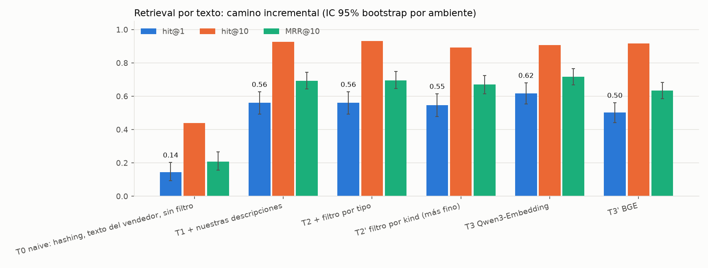
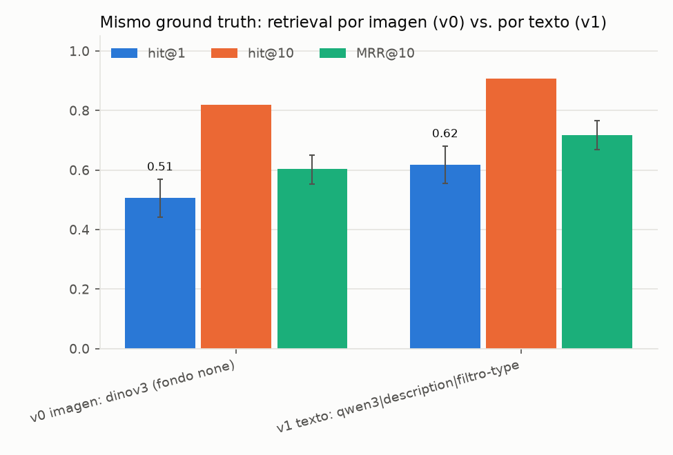

# Retrieval por texto (65 ambientes IKEA)

Corrida: `20261021-133226_ablacion-texto`.

| método                             | embedder   | texto            | filtro   |   consultas |   hit@1 | hit@1_ic95     |   hit@3 |   hit@10 |   mrr@10 | mrr@10_ic95    |   recall_item@10 |   azar_hit@1 |
|:-----------------------------------|:-----------|:-----------------|:---------|------------:|--------:|:---------------|--------:|---------:|---------:|:---------------|-----------------:|-------------:|
| hashing|description|filtro-kind    | hashing    | description      | kind     |         207 |  0.5459 | [0.478, 0.615] |  0.7536 |   0.8937 |   0.6698 | [0.615, 0.725] |           0.8426 |       0.0358 |
| hashing|description|filtro-type    | hashing    | description      | type     |         207 |  0.5604 | [0.493, 0.627] |  0.8019 |   0.9324 |   0.6963 | [0.647, 0.748] |           0.8796 |       0.0196 |
| hashing|description|filtro-none    | hashing    | description      | none     |         207 |  0.5604 | [0.493, 0.627] |  0.7874 |   0.9275 |   0.6924 | [0.643, 0.744] |           0.8796 |       0.0048 |
| hashing|seller|filtro-kind         | hashing    | seller           | kind     |         207 |  0.1932 | [0.127, 0.267] |  0.3285 |   0.6957 |   0.3144 | [0.259, 0.377] |           0.6528 |       0.0358 |
| hashing|seller|filtro-type         | hashing    | seller           | type     |         207 |  0.1546 | [0.101, 0.218] |  0.2512 |   0.5604 |   0.2469 | [0.195, 0.307] |           0.5231 |       0.0196 |
| hashing|seller|filtro-none         | hashing    | seller           | none     |         207 |  0.1449 | [0.094, 0.203] |  0.2126 |   0.4396 |   0.2083 | [0.158, 0.266] |           0.4167 |       0.0048 |
| bge|description|filtro-kind        | bge        | description      | kind     |         207 |  0.4976 | [0.432, 0.560] |  0.7101 |   0.8937 |   0.6197 | [0.566, 0.673] |           0.8519 |       0.0358 |
| bge|description|filtro-type        | bge        | description      | type     |         207 |  0.5024 | [0.441, 0.561] |  0.7343 |   0.9179 |   0.6337 | [0.585, 0.684] |           0.8935 |       0.0196 |
| bge|description|filtro-none        | bge        | description      | none     |         207 |  0.5024 | [0.441, 0.561] |  0.7246 |   0.9179 |   0.6315 | [0.583, 0.683] |           0.8935 |       0.0048 |
| bge|seller|filtro-kind             | bge        | seller           | kind     |         207 |  0.2367 | [0.173, 0.300] |  0.4106 |   0.6473 |   0.3476 | [0.285, 0.407] |           0.6204 |       0.0358 |
| bge|seller|filtro-type             | bge        | seller           | type     |         207 |  0.1884 | [0.134, 0.243] |  0.3575 |   0.5749 |   0.2946 | [0.241, 0.351] |           0.5694 |       0.0196 |
| bge|seller|filtro-none             | bge        | seller           | none     |         207 |  0.1884 | [0.134, 0.243] |  0.3527 |   0.5556 |   0.2905 | [0.236, 0.348] |           0.5556 |       0.0048 |
| qwen3|description|filtro-kind      | qwen3      | description      | kind     |         207 |  0.599  | [0.536, 0.662] |  0.7633 |   0.8744 |   0.6903 | [0.637, 0.743] |           0.8333 |       0.0358 |
| qwen3|description|filtro-type      | qwen3      | description      | type     |         207 |  0.6184 | [0.555, 0.681] |  0.8019 |   0.9082 |   0.7172 | [0.668, 0.765] |           0.8889 |       0.0196 |
| qwen3|description|filtro-none      | qwen3      | description      | none     |         207 |  0.6184 | [0.555, 0.681] |  0.8019 |   0.8986 |   0.7152 | [0.666, 0.764] |           0.8796 |       0.0048 |
| qwen3|seller|filtro-kind           | qwen3      | seller           | kind     |         207 |  0.2077 | [0.155, 0.265] |  0.3865 |   0.657  |   0.3277 | [0.275, 0.382] |           0.625  |       0.0358 |
| qwen3|seller|filtro-type           | qwen3      | seller           | type     |         207 |  0.1643 | [0.118, 0.213] |  0.2995 |   0.5894 |   0.2686 | [0.220, 0.317] |           0.5556 |       0.0196 |
| qwen3|seller|filtro-none           | qwen3      | seller           | none     |         207 |  0.1643 | [0.118, 0.213] |  0.2995 |   0.5749 |   0.2655 | [0.217, 0.314] |           0.5509 |       0.0048 |
| bge|name+description|filtro-kind   | bge        | name+description | kind     |         207 |  0.4589 | [0.398, 0.517] |  0.6715 |   0.8502 |   0.5814 | [0.530, 0.632] |           0.8148 |       0.0358 |
| qwen3|name+description|filtro-kind | qwen3      | name+description | kind     |         207 |  0.4831 | [0.417, 0.544] |  0.7198 |   0.8406 |   0.6031 | [0.554, 0.653] |           0.8009 |       0.0358 |

## Texto vs. imagen

| | consultas | hit@1 | hit@10 | MRR@10 |
|---|---|---|---|---|
| v0 imagen (20261006-231131_retriever_abl-retriever-name-dinov3__method-none__category_filter-true) | 325 recortes | 0.508 | 0.819 | 0.603 |
| v1 texto (qwen3|description|filtro-type) | 207 consultas | 0.618 | 0.908 | 0.717 |

